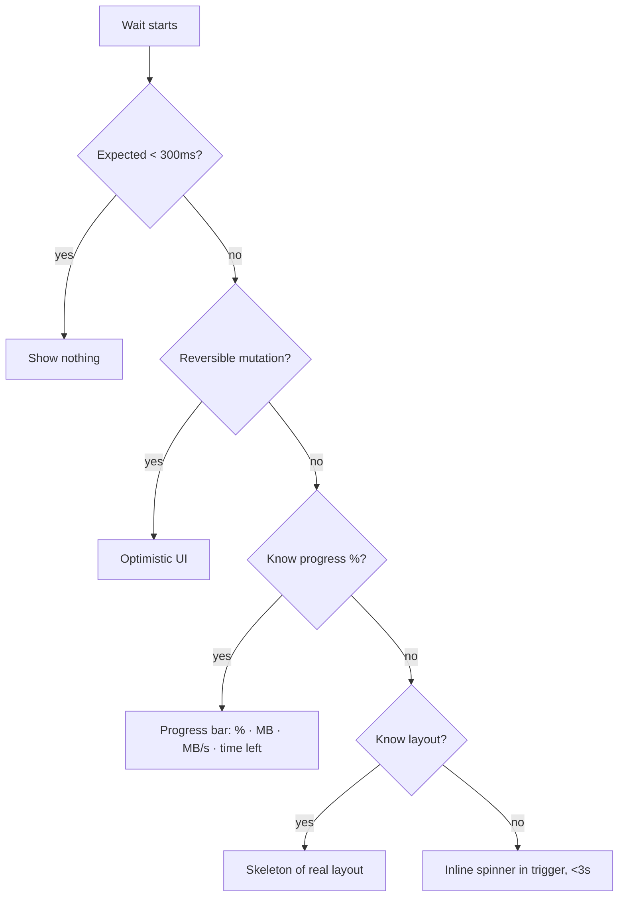
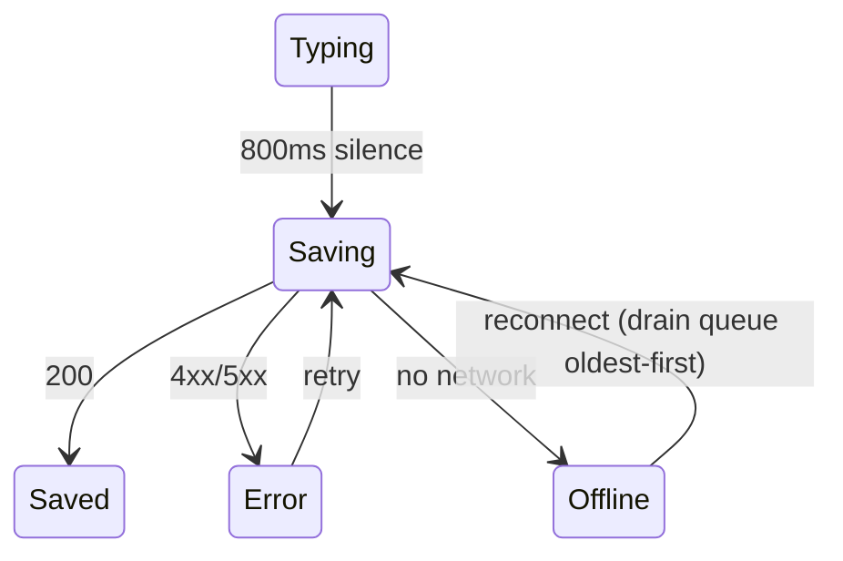

# Feedback, loading, errors, notifications, undo, saving

Rules from Design Motion (designmotionhq.com/patterns + Design Motion reels). Numbers come from those sources unless labeled "(standard, not from Design Motion)". Reel URLs: https://www.facebook.com/reel/<id>.

## Quick numbers

| Thing | Number | Source |
|---|---|---|
| Press feedback | < 100 ms | animation-timing |
| Doherty threshold (some response) | ≤ 400 ms | doherty-threshold |
| Show nothing if load is | < 300 ms | reel 966287759692721 |
| Spinner only for unknown waits | < 3 s | reel 966287759692721 |
| Progress bar for known % | > 3 s | reel 966287759692721 |
| Optimistic UI: user sees result | 0 ms (sync ~300 ms behind) | reel 966287759692721 |
| Copy button: flip to check | same frame (not after 192–480 ms spinner); reset after 2 s | reel 1087480894228525 |
| Toast auto-dismiss | info 4 s, warning 7 s, error until acknowledged; max 3 visible | reel 2149760112506033 |
| Undo grace for "send" | 10 s | reel 2126158401583676 |
| Hold-to-delete | 300 ms hold, release early = nothing | reel 1052845123926917 |
| Autosave debounce | 800 ms of silence → 1 write | reel 1846879053403558 |
| Toggle morph | 250 ms ease-out, 4 properties | reel 27114469058187838 |
| Inline validation | "kills 80% of errors" | reel 1011539707965282 |

---

### 1. Feedback under 100 ms; some response within 400 ms

**Rule** Every press shows a visual reaction in < 100 ms; every action shows *some* response (state change, skeleton, spinner) within 400 ms.
**Why** Past ~400 ms users disconnect from the action (Doherty threshold).
**Numbers** < 100 ms press; ≤ 400 ms response.
**Schema**
```
tap ─┬─ 0–100ms: pressed state (scale/colour)
     └─ ≤400ms: result OR loading indicator
```
**Good vs Bad** Good: button darkens on pointerdown, label changes to "Saving…" immediately. Bad: nothing changes until the request returns 1.2 s later.
**How to check** DevTools → throttle "Slow 3G"; record performance; first visual change after click must be < 100 ms.
**Source** https://designmotionhq.com/patterns/animation-timing, https://designmotionhq.com/patterns/doherty-threshold

### 2. Pick the loading pattern by what you know about the wait

**Rule** Choose by duration and knowledge, never one default:
- < 300 ms → **show nothing** (a skeleton that flashes for 200 ms looks like a glitch).
- Layout known, > 300 ms → **skeleton** shaped like the real content, animated.
- Duration unknown, short (< 3 s) → **inline spinner** inside the control that triggered it ("Save changes" with spinner), not a full-page "Loading dashboard…".
- Known %, > 3 s (uploads, installs, builds) → **progress bar** with % + size + speed + time left.
- Reversible mutation → **optimistic** (rule 3).
**Why** "Perceived speed beats actual speed every time." Skeletons set expectation "shape first". A context-free spinner = "No context. No progress. No trust."
**Numbers** 300 ms, 3 s thresholds (reel 966287759692721).
**Schema**

**Good vs Bad**
```
Good: [project-build.zip ███████░░ 85%  12.0 of 14.2 MB · 2.2 MB/s · 1s remaining]
Bad : (○ Loading dashboard...)         ← no context, no progress
```
```jsx
// delay the skeleton so fast loads show nothing
const showSkeleton = useDelayed(isLoading, 300);
```
**How to check** For each fetch, record typical latency and the indicator used; flag skeletons visible < 300 ms, spinners shown > 3 s, full-page spinners for local actions.
**Source** https://www.facebook.com/reel/966287759692721, https://designmotionhq.com/patterns/loading-states-system, https://designmotionhq.com/patterns/skeleton-loading

### 3. Optimistic only for reversible actions; roll back on failure (merged)

See **motion.md § 9 (Optimistic UI for reversible actions)** — canonical rule; merged here to avoid duplication.

### 4. Cover every state

**Rule** Every data component designs: loading, empty, error, success, plus partial, offline and long/real content where relevant ("Real content breaks layouts" — a 30-character name pushed a button out of the card).
**Numbers** 30-character name stress test (reel 1051915977228458).
**Schema**
```
idle → loading → success | empty | error(retry→loading) | offline(queue)
```
**Good vs Bad** Good: storybook story per state incl. "Bartholomew Vandermeer-Okonkwo". Bad: only the happy path with 5-letter names. CSS fix: `.name{overflow:hidden;text-overflow:ellipsis;min-width:0}` ("min-width: 0, or no ellipsis"); for filenames cut the middle: `quarterly_rep…nal_v3.pdf`.
**How to check** Enumerate states per component; each has a design/story. Paste a 30+ char value into every name field.
**Source** https://www.facebook.com/reel/1051915977228458, https://www.designmotionhq.com

### 5. Match the error to its surface (severity → surface)

**Rule** 4 error types, 4 surfaces:
| Type | Surface | Traits |
|---|---|---|
| Validation | inline under field | small, specific, non-blocking |
| Network | toast/banner "No connection. Reconnecting…" | transient |
| Server | full surface "Something broke on our end." | blocking |
| Permission | full surface "You don't have access." + Sign in | blocking |
**Why** "Don't show a 500 modal for a typo." "Most apps overuse modals."
**Schema** `LOW severity ── inline ── toast ── modal ── HIGH severity`
**Good vs Bad** Good: "Email already in use" under the field. Bad: modal "Error 500. An error occurred. [OK]" for a field typo.
**How to check** Trigger each type (bad input, offline, 500, 403) and record the surface; compare with the table.
**Source** https://www.facebook.com/reel/1011539707965282, https://designmotionhq.com/patterns/error-states

### 6. Every error needs an exit and human copy

**Rule** Say what happened, then give 1. Retry, 2. Escalate (support), 3. Explain. Never only "OK". Never raw codes ("Code: 0x80004005"). Keep the user's typed data on failure.
**Numbers** Example copy: "Network timed out after 30s." / "Lost connection. Reconnecting in 4 seconds…".
**Good vs Bad**
```
Bad : Something went wrong. [OK]
Good: Something went wrong — network timed out after 30s.
      [Retry] [Contact support] [What happened?]
```
**How to check** Every error view has ≥ 1 recovery action besides dismiss; no error string contains a hex/stack code; form values survive a failed submit.
**Source** https://www.facebook.com/reel/1011539707965282, https://designmotionhq.com/patterns/error-states

### 7. Prevent errors with live inline validation

**Rule** Validate as rules are satisfied (checklist that ticks: "At least 8 characters ✓ Contains a number ✓ Contains a special char"), not a single error after submit. Don't scream "Invalid email" while the user is still typing — validate on blur / after a pause.
**Numbers** "Inline validation kills 80% of errors."
**Good vs Bad** Good: live checklist under password. Bad: submit → "Password must contain a number".
**How to check** Fill the form wrongly; count errors only revealed after submit (target 0 for format rules); type one character in email → no error yet.
**Source** https://www.facebook.com/reel/1011539707965282, https://www.facebook.com/reel/1944524912916993, https://designmotionhq.com/patterns/error-states

### 8. Notification volume matches severity (toast / banner / modal / badge)

**Rule** Same content, four volumes; "the trigger picks the volume":
| Trigger | Surface | Lifecycle |
|---|---|---|
| New message, "Comment posted" | toast | auto-dismiss |
| Server degraded ("latency above 2s"), sync paused | banner | manual — stays until user/condition clears |
| Card declined → "Card 4242. Use another?" | modal | blocking — demands a choice |
| 3 unread comments | badge | quiet — until cleared |
Never stack modals ("Three modals? Trainwreck"); stacked toasts must breathe.
**Why** Users tune out over-escalated noise. "Persistence is part of the contract."
**How to check** List every notification trigger with its surface; flag modals for non-blocking info, toasts for things needing action, >1 modal open at once.
**Source** https://www.facebook.com/reel/2282515145835327, https://designmotionhq.com/patterns/notification-system

### 9. Toasts: position, timing, stacking, dismissal, colour

**Rule**
1. Position: desktop bottom-right, mobile top; never centre ("Center blocks what users are actually doing").
2. Timing: info 4 s auto-dismiss; warning (e.g. "Session expiring") 7 s; failure ("Payment failed") until acknowledged.
3. Stacking: max 3 visible, oldest leaves; spring damping 20 / stiffness 180 (reel values).
4. Dismissible: close button, swipe on mobile, hover pauses the timer.
5. Colour + icon per type: info ("Update available"), success ("Saved to drafts"), warning ("Quota almost up — 92% of plan used"), error ("Connection lost — Retrying in 5 seconds").
**Schema**
```
desktop ┌──────────────┐   mobile ┌────────┐
        │              │          │[toast] │
        │      [toast] │          │        │
        │      [toast] │◀ max 3   │        │
        └──────────────┘          └────────┘
```
**Good vs Bad** Good: `toast.error("Payment failed", {duration: Infinity, action: "Retry"})`. Bad: `toast("Payment failed", {duration: 4000})` centred.
**How to check** Fire 5 toasts: ≤ 3 visible; hover pauses; error stays; measure durations 4 s / 7 s.
**Source** https://www.facebook.com/reel/2149760112506033, https://designmotionhq.com/patterns/toast-notifications

### 10. Undo beats "Are you sure?"; deletion is a state

**Rule** Act immediately and offer Undo; soft-delete ("off the screen, not the database" — a `deleted` flag, not a row removal). Keep an undo stack for editors ("Figma remembers. Your app can too"). For sends, a delayed send with visible countdown.
**Why** Confirm = "3 clicks — every time"; undo = "1 click — regret optional". "Punish the 1%, or protect them."
**Numbers** 3 clicks vs 1 click; delayed send 10 s grace with countdown ("The delay is the feature").
**Schema**
```
[Delete] → row hidden + toast "Deleted report.pdf  [Undo] 10s…" → after timeout: committed (still soft-deleted, recoverable)
```
**Good vs Bad**
```sql
-- Good: UPDATE files SET deleted_at = now() WHERE id = :id;
-- Bad : DELETE FROM files WHERE id = :id;
```
**How to check** Count confirmation dialogs guarding reversible actions (target 0); every delete toast has Undo; DB uses soft delete.
**Source** https://www.facebook.com/reel/2126158401583676, https://designmotionhq.com/patterns/undo-ux, https://designmotionhq.com/patterns/bulk-actions, https://designmotionhq.com/patterns/drag-and-drop

### 11. Match friction to the cost of destructive actions

**Rule** Friction scale: reversible → Undo; annoying-to-redo → Confirm with named verbs; irreversible → type-to-confirm (type the resource name) or hold-to-confirm. Buttons name the action ("Delete project" / "Keep project"), never "Yes/No" — "The verb is the warning." Red only for destruction; danger zone at the bottom of settings; put the destructive button off the usual confirm spot.
**Numbers** Hold-to-delete: 300 ms ring fills (0→100→200→300 ms), release early → "Nothing deleted". Dialog copy states scope: "permanently removes Q3 Campaign and its 84 assets for everyone on the team".
**Schema** `reversible ── Undo ── Confirm ── Type/Hold to confirm ── irreversible`
**Good vs Bad**
```
Bad : Are you sure?            [No] [Yes]
Good: Delete this project?
      Permanently removes <name> and its <n> assets for everyone.
                               [Keep project] [Delete project]
```
**How to check** Grep dialogs for "Yes"/"OK" buttons on destructive actions; red used on non-destructive actions = finding; irreversible deletes require typing or holding.
**Source** https://www.facebook.com/reel/1052845123926917, https://www.facebook.com/reel/2126158401583676, https://designmotionhq.com/patterns/destructive-actions, https://designmotionhq.com/patterns/settings-system

### 12. Autosave is a system: debounce, honest status pill, offline queue, conflicts, nav guard

**Rule**
1. Debounce: write after 800 ms of silence (6 keystrokes → 1 write).
2. Status pill is a state machine: Typing → Saving… → Saved / Offline / Couldn't save. "Users trust the pill. Never let it lie" (never "Saved." when "3 edits never left this tab").
3. Offline queue: every edit waits locally; on reconnect drain oldest first, show "Synced 3/4".
4. Conflicts (two tabs): "Merge or warn — never overwrite in silence" (no blind last-write-wins).
5. Navigation guard: `beforeunload` when unsaved — "One ugly dialog beats an afternoon retyped."
**Schema**

**Good vs Bad**
```js
window.addEventListener('beforeunload', e => { if (pending > 0) e.preventDefault(); });
```
Bad: pill shows "Saved" from a local timer, not the server response.
**How to check** Type 6 chars quickly → network shows 1 PATCH; go offline, edit, pill says Offline/"n changes pending"; reconnect → edits arrive in order; edit in two tabs → merge or warning; close tab with pending edits → browser prompt.
**Source** https://www.facebook.com/reel/1846879053403558

### 13. Upload feedback: drag response, honest progress, per-file lanes, resume

**Rule**
1. Drop zone answers before the drop with 3 signals: border, glow, copy ("Release to upload hero-banner.png — 2.4 MB"). "Users hesitate when nothing moves."
2. Honest progress, not a spinner: % + time left + speed ("80% · 4s left · 2.2 MB/s") so users can "wait or walk away".
3. Independent lanes: each file its own progress and Retry; "One failure never blocks the others" ("4 of 5 done · 1 failed").
4. Resume, don't restart: connection lost at 90% → file kept, "Resuming from 90%…", one tap resumes.
5. "A filename is not feedback" — show a thumbnail/result, not just "IMG_4032.jpg uploaded".
**Schema**
```
Uploading 5 files — 4 of 5 done · 1 failed
brief.pdf          ██████████ ✓
demo.mp4           ████████░░ 80% · 4s
invoice.pdf        ✕ failed   [Retry]
```
**How to check** Drag a file over: 3 visual changes before release; upload 5 files with one forced to fail: others complete; cut network at ~90%: resume without re-selecting.
**Source** https://www.facebook.com/reel/1029052806542981, https://designmotionhq.com/patterns/drag-and-drop

### 14. Copy-to-clipboard needs proof

**Rule** Flip the icon to a check on the same frame (no spinner); hold, then reset after 2 s so a 2nd copy signals again; copy the raw value (no wrapping spaces/newlines from display formatting); announce "Copied" via an ARIA live region; fall back when the Clipboard API is unavailable (insecure origins).
**Numbers** Spinner versions wait 192–480 ms before confirming — wrong; reset after 2 s.
**Good vs Bad**
```jsx
<button onClick={() => { navigator.clipboard.writeText(raw); setCopied(true); setTimeout(()=>setCopied(false),2000); }}>
  {copied ? <Check/> : <Copy/>}</button>
<span aria-live="polite">{copied ? "Copied" : ""}</span>
```
Bad: icon stays as ✓ forever ("Stuck forever"), copies "sk_live_a3f2 9c7b 8e14d0" with display spaces.
**How to check** Click copy: check appears in the same frame; returns to copy icon at 2 s; pasted value byte-equals source; screen reader announces.
**Source** https://www.facebook.com/reel/1087480894228525

### 15. Switches: morph, instant apply, accessible

**Rule** A switch applies immediately (optimistic, rule 3); use it for on/off settings that take effect now. Morph 4 properties together — rail colour (neutral→accent), knob translateX, knob shadow, label — 250 ms ease-out; don't snap. Geometry: rail width = 2× knob, padding = knob radius. Real switch semantics: Space toggles, visible focus ring, `role="switch"` + `aria-checked`.
**Numbers** 250 ms ease-out; width = 2× knob; pad = knob radius.
**Note** Use a checkbox instead when the choice is applied later by a Submit button (standard, not from Design Motion).
**Good vs Bad**
```jsx
<button role="switch" aria-checked={on} onClick={toggle} className="rail">
  <span className="knob" /></button>
/* .knob{transition:transform 250ms ease-out} */
```
Bad: `<div onClick>` fake toggle with no focus ring and no aria-checked.
**How to check** Tab to switch → focus ring; Space toggles; screen reader reads "on/off"; transition 250 ms; force 500 → reverts with "Couldn't save — try again".
**Source** https://www.facebook.com/reel/27114469058187838, https://designmotionhq.com/patterns/toggle-anatomy

### 16. Disabled buttons must explain themselves

**Rule** A disabled submit that silently ignores clicks fails: keyboard Tab skips it, the tooltip never fires (no pointer events), and screen readers stay silent. Prefer an enabled button that shows what's missing on click, or keep it focusable (`aria-disabled`) with a visible reason.
**Numbers** Reel shows 3 clicks with 0 events; contrast for the label still needs 4.5:1 (standard WCAG AA, shown in reel).
**Good vs Bad**
```jsx
// Good
<button aria-disabled={!valid} onClick={() => !valid && showMissing()}>Create project</button>
<p>Select a region and accept the terms</p>
// Bad
<button disabled>Create project</button>
```
**How to check** Click/Tab/screen-read a disabled primary button: user must learn why it's disabled.
**Source** https://www.facebook.com/reel/1227415986172701

### 17. Pull-to-refresh: threshold and resistance

**Rule** Fire only past a threshold — release below snaps back with no reload ("Let go early. Nothing loads."). Add elastic resistance so content moves less than the finger (reel shows elastic vs 1:1 "cheap") — "Resist like the content has weight."
**Numbers** Elastic ratio shown as 4:1 vs 1:1 cheap; example pull distance 94 px. (Exact threshold px not stated.)
**How to check** Pull short and release → no network request; pull long → one refresh; content offset < finger travel.
**Source** https://www.facebook.com/reel/2286226512205780

### 18. Choose overlay by "does it block?" (merged)

See **hierarchy-and-actions.md § 10 (Pick the right container)** — canonical rule; merged here to avoid duplication.

### 19. Tooltips: 300 ms delay, arrow, flip at edges, dismiss everywhere, one sentence ≤ 300 px

**How to check** Hover → appears after 300 ms; Esc/scroll/click-away dismiss; near viewport edge flips; width ≤ 300 px.
**Source** https://designmotionhq.com/patterns/tooltip-design

### 20. Command palette / search feedback

**Rule** Fuzzy match, grouped results, recents on open, keyboard-driven; async commands show an inline spinner while the palette stays open ("Results load in place").
**Source** https://www.facebook.com/reel/2157566511696771, https://www.facebook.com/reel/2033483404036598, https://designmotionhq.com/patterns/command-palette, https://designmotionhq.com/patterns/search-experience-system

### 21. Context menus

**Rule** Flip into viewport, group by intent, isolate delete in red at the bottom, long-press on mobile.
**Source** https://www.facebook.com/reel/1030653972707108, https://designmotionhq.com/patterns/context-menu

### 22. Drag & drop feedback

**Rule** Lift cues on grab, drop target shown before release, snap into place, undo after drop.
**Source** https://www.facebook.com/reel/860578686523731, https://www.facebook.com/reel/1114841577734481, https://designmotionhq.com/patterns/drag-and-drop
