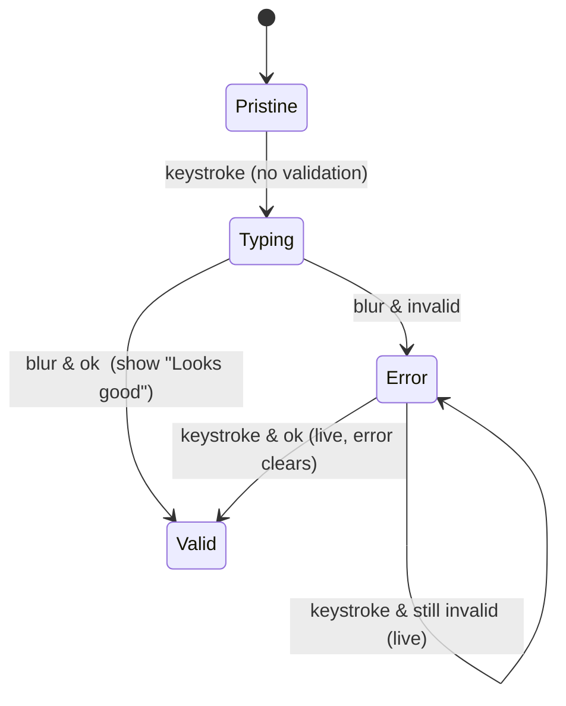

# Forms, inputs and permission requests

Sources: Design Motion pattern pages (designmotionhq.com/patterns) and Design Motion reels (facebook.com/reel/<id>, caption + on-screen text).
Anything not from Design Motion is marked "(standard, not from Design Motion)". Reel brand names (e.g. "Northbeam", "Streakly") are fictional demo apps.

Severity hint for reviewers: rules 1–6 and 9 break completion or accessibility (high); the rest are polish/conversion (medium).

---

### 1. Ask for each permission once, right after the action that needs it

**Rule** Never fire OS permission prompts on first launch. Ask one permission at a time, immediately after the user does the thing that needs it (sets a reminder → notifications; taps Scan → camera). Show your own pre-card first, say what they gain, and if denied, give a way back to Settings.

**Why** "Your app gets one real shot at Allow." A system prompt denied on first launch is "denied forever" – the OS will not show it again. The reel walks through 5 mistakes: timing, no pre-card, vague copy, dead end, all at once.

**Numbers**
- 5 mistakes / 5 fixes: *ask after*, *own card*, *say the gain*, *link to Settings*, *one at a time*.
- System prompts per screen: max 1.
- Prompts on first launch: 0.

**Schema**
```
BAD   launch ─► [Allow notifications?] ─► [Allow location?] ─► [Allow camera?] ─► empty home
GOOD  launch ─► home ─► user creates "Drink water, 8:00 PM" ─► Saved
                         └─► own card: "Get a reminder at 8 pm"  [Turn on] [Not now]
                                └─► Turn on ─► OS dialog (system prompt still available if "Not now")
      denied ─► Reminders screen: "Notifications are off. You won't get reminders." [Open Settings]
```

**Good vs Bad**
- Copy. Bad: "We'd like to send you notifications. Stay up to date." Good: "Get a reminder at 8 pm – Drink water, every evening."
- Camera. Bad: camera prompt at launch. Good: prompt appears on tap of "Scan the box", text "To scan your medication box."
- Denied state. Bad: "Notifications are off" with no action. Good: same text + `Open Settings` button.

**How to check**
- Fresh install: count OS prompts before the first meaningful action → must be 0.
- Each prompt fires within the flow that uses it (record the triggering tap).
- An in-app pre-card precedes every OS prompt; tapping "Not now" does NOT consume the OS prompt.
- Deny each permission → feature screen shows the state + a deep link to Settings.

**Source** https://www.facebook.com/reel/1106572468837831

---

### 2. A placeholder is not a label – persistent label above, helper text below

**Rule** Every field has a visible label outside the input (above, or a floating label that stays visible on focus/typing). Helper text sits below. Placeholder is only an example value.

**Why** The placeholder vanishes as soon as the user types; a field with "0421" in it could be "postal? phone? code?" (signup reel). Placeholder-as-label "vanishes when typing".

**Numbers** 0 fields where the placeholder is the only label.

**Schema**
```
Email                       ← label (always visible)
┌───────────────────────────┐
│ you@example.com           │ ← placeholder = example only
└───────────────────────────┘
We'll never share your email ← helper
```

**Good vs Bad**
```html
<!-- Bad -->
<input placeholder="Postal code">
<!-- Good -->
<label for="zip">Postal code</label>
<input id="zip" placeholder="04210" aria-describedby="zip-help">
<small id="zip-help">5 digits</small>
```

**How to check** Fill every field, then look at the filled form: can each value's meaning be read without clearing it?

**Source** https://www.facebook.com/reel/1440498064725043, https://www.facebook.com/reel/26902587206039051, https://designmotionhq.com/patterns/form-field-states, https://designmotionhq.com/patterns/microcopy

---

### 3. Design all six field states

**Rule** Every input ships with: default, focus, error, success, disabled, loading. "One forgotten = one bug." "Most apps ship two."

**Why** Each missing state turns into a visible bug (invisible errors, double submits, fake-loading disabled fields).

**Numbers**
| State | Rule from reel | Avoid |
|---|---|---|
| 1 Default | Label outside, helper below | Placeholder-as-label |
| 2 Focus | Ring contrast **≥ 3:1** (example shown 4.6:1) | Soft blue glow (fails a11y) |
| 3 Error | Colour **+ icon + message** | Border-only red – "invisible to 12% of users" |
| 4 Success | Confirm inside the field ("Email available ✓") | Toasts – steal focus, vanish too fast |
| 5 Disabled | Grayscale background + `cursor: not-allowed` | `opacity: 0.5` – looks like loading |
| 6 Loading | Spinner inside + disable the input ("Checking availability…") | No loading state = double-submit bug |

**Schema**
```
default ─focus─► focus ─blur─► (valid) success
                         └──► (invalid) error ─fix─► success
async check: focus/blur ─► loading ─► success | error
```

**Good vs Bad**
```css
/* Bad */ .input.error{border-color:red}  .input:disabled{opacity:.5}
/* Good */
.input:focus-visible{outline:2px solid var(--focus);outline-offset:2px} /* ≥3:1 vs bg */
.input[aria-invalid=true]{border-color:var(--danger)}      /* + icon + text below */
.input:disabled{background:var(--gray-100);color:var(--gray-500);cursor:not-allowed}
```

**How to check** Storybook/state sheet shows all 6 per field type; measure focus ring contrast ≥ 3:1; grayscale screenshot: errors still identifiable (icon + text).

**Source** https://www.facebook.com/reel/26902587206039051, https://designmotionhq.com/patterns/form-field-states

---

### 4. Validate on blur; after an error, go live; confirm success

**Rule** Don't validate on each keystroke ("Correct, but cruel") nor only on submit ("Too late" – all errors at once). Check when the user leaves the field. Once a field has errored, re-validate live so the error clears the moment it's fixed. Confirm right values too ("Looks good") – "Silence feels judged". Motto: "Scold late. Praise early."

**Why** "Still typing. Already wrong?" – timing is the whole UX.

**Numbers** Errors shown while the user is still typing a fresh field: 0. Error→live switch: after the first error on that field.

**Schema**


**Good vs Bad**
- Bad: typing "al" in Email shows "Invalid email".
- Good: "alex@email.com" + Tab → "✓ Looks good"; "alex@ema" + Tab → "Enter full email address"; continue typing → error disappears at ".com".
- Card numbers: same rule – "Validate on blur, not keystroke" (4242 42… stays neutral while typing).

**How to check** Type a partial email: no error until blur. Trigger error, then fix: error clears without another blur. Valid field shows a positive confirmation.

**Source** https://www.facebook.com/reel/1944524912916993, https://www.facebook.com/reel/1440498064725043, https://www.facebook.com/reel/4388536218092850, https://www.facebook.com/reel/2083206399748282, https://designmotionhq.com/patterns/form-validation-timing, https://designmotionhq.com/patterns/error-states

---

### 5. Don't disable the submit button – validate on click and explain

**Rule** Keep the primary button live. On click, highlight every blocking field, show an inline message per blocker ("Pick a region", "Accept the terms"), a count ("2 to fix") and move focus to the first one. While submitting, use a busy state (`aria-busy="true"`), not `disabled`. The submit button must also never move or jump ("The button never moves").

**Why** A disabled button is removed from tab order ("The keyboard skips right past it"), has no pointer events so "the tooltip never fires", and grey text often fails contrast (4.5:1 required). Users click 3+ times with no feedback. Disabling during loading loses focus; busy keeps it.

**Numbers** Text contrast on the button ≥ 4.5:1 (shown in reel). Blocker counter decreases live ("2 to fix" → "1 to fix" → "all clear").

**Schema**
```
[Create project] click
   └─► VALIDATION: 2 to fix
        ⚠ Region — Pick a region     ← focus moves here
        ⚠ Terms  — Accept the terms  (queued)
   fix region ─► "1 to fix" ─► fix terms ─► "all clear" ─► submit
   submit ─► aria-busy="true" (focus kept, announced) ─► "Project created ✓"
```

**Good vs Bad**
```jsx
// Bad
<button disabled={!isValid}>Create project</button>
// Good
<button onClick={handleSubmit} aria-busy={saving} aria-describedby="form-errors">
  {saving ? <Spinner/> : "Create project"}
</button>
// handleSubmit: if errors -> setShowErrors(true); focus(firstInvalidRef)
```

**How to check** Tab through an incomplete form: the button is reachable. Click it: each blocker is named in text and focus lands on the first. During submit the button stays focused and can't double-submit. Button position identical before/after errors appear.

**Source** https://www.facebook.com/reel/1227415986172701, https://www.facebook.com/reel/1440498064725043, https://designmotionhq.com/patterns/disabled-buttons

---

### 6. Button labels name the reward; errors name the next move

**Rule** Primary buttons say the outcome ("Create my free account", "Create account", "Pay $148.00"), not "Submit". Error messages say how to fix ("Enter full email address", "Password is too short", "Code needs digits", "That email's taken — want to log in?"), not "Invalid input".

**Why** Copy shapes conversion and recovery.

**Numbers** 0 buttons labelled "Submit"/"OK" on primary flows; 0 errors without a corrective verb.

**Good vs Bad** Bad: "Invalid email" / "Error 422". Good: "Email format is invalid — check the @ symbol".

**How to check** Export every button and error string; flag generic ones.

**Source** https://www.facebook.com/reel/26902587206039051, https://www.facebook.com/reel/1440498064725043, https://designmotionhq.com/patterns/microcopy, https://designmotionhq.com/patterns/error-states

---

### 7. Give every field the right keyboard and autofill hints – and style autofill

**Rule** A code is not a number: use `inputmode="numeric"` + `pattern="[0-9]*"` + `autocomplete="one-time-code"` (not `type="number"`). Treat browser autofill as a state and style it so it matches your theme.

**Why** Wrong keyboard slows mobile entry; `type=number` drops leading zeros (e.g. "04210"). Unstyled autofill paints a foreign yellow/blue background over your design ("Autofill is state. Style it.").

**Numbers** Every code/OTP field has all 3 attributes.

**Good vs Bad**
```html
<!-- Bad --> <input type="number" id="code">
<!-- Good -->
<label for="code">Verification code</label>
<input id="code" inputmode="numeric" pattern="[0-9]*" autocomplete="one-time-code">
```
```css
input:autofill{ box-shadow:0 0 0 1000px var(--surface-2) inset; -webkit-text-fill-color:var(--text); }
```
Also (standard, not from Design Motion): `autocomplete="email"`, `"new-password"`, `"postal-code"`, `"cc-number"`; mobile inputs ≥16px font so iOS doesn't zoom on focus (the "No zoom when you type" reel names the problem; the 16px value is the iOS standard).

**How to check** On a phone, focus each field: correct keyboard opens. Autofill the form: colours match the design. Leading zeros survive.

**Source** https://www.facebook.com/reel/1440498064725043, https://www.facebook.com/reel/952258174225932

---

### 8. Format as typed, store raw (card numbers and other long numbers)

**Rule** Group 16 card digits 4-4-4-4; detect brand from the first digit (4 Visa, 5 Mastercard, 3 Amex); keep the caret where it was when a space is inserted; strip pasted junk ("4242-4242-4242-4242" → dashes removed, re-grouped); show formatted, store raw.

**Numbers** Groups of 4; brand on digit 1; stored value has 0 separators.

**Schema**
```
user sees:  4242 4242 4242 4242  [VISA]
you store:  {"cardNumber":"4242424242424242"}
paste "4242-4242-4242-4242" ─► strip /\D/g ─► regroup ─► caret at end
```

**Good vs Bad**
```js
const raw = e.target.value.replace(/\D/g, "");        // store this
const shown = raw.replace(/(\d{4})(?=\d)/g, "$1 ");  // display this, then restore caret
```
Bad: rejecting a paste with dashes; caret jumping to the end on every keystroke.

**How to check** Paste with dashes/spaces → accepted. Edit a middle digit → caret stays. Inspect payload → digits only.

**Source** https://www.facebook.com/reel/4388536218092850, https://www.facebook.com/reel/2083206399748282, https://designmotionhq.com/patterns/input-masking

---

### 9. OTP: six boxes, one value, paste-first

**Rule** Treat the 6 boxes as one value. Paste once → strip non-digits → fill all six. Typing a digit moves focus to the next box; backspace on an empty box jumps back. `inputmode="numeric"`. Resend is locked behind a visible 30s countdown and re-enables at zero. Wrong code shakes and clears, focus returns to box 1; right code locks in green. Never fail silently.

**Why** Six independent inputs break paste and autofill. Without a resend timer users spam the button and get "429 Too Many Requests" – "No throttle = they rate-limit themselves."

**Numbers** 6 digits; resend timer 30s (0:30 → 0:00); wrong code → cleared + focus box 1.

**Schema**
```
paste " 847 291 " ─► .replace(/\D/g,"") ─► 847291 ─► [8][4][7][2][9][1] ─► auto-submit
                                                       ├─ wrong ─► shake, clear, focus [ ]1
                                                       └─ right ─► all boxes green ✓
Resend code (0:30… disabled with visible timer) ─► 0:00 ─► enabled
```

**Good vs Bad**
```jsx
onPaste={e=>{const d=e.clipboardData.getData("text").replace(/\D/g,"").slice(0,6); setDigits(d.split(""));}}
onKeyDown={e=>{ if(e.key==="Backspace" && !digits[i]) focus(i-1); }}
```
Bad: a resend link that can be clicked repeatedly; wrong code with no feedback.

**How to check** Paste "847 291" → all boxes filled. Backspace from empty box 4 → focus box 3. Click resend → countdown 30s visible. Enter wrong code → shake + clear.

**Source** https://www.facebook.com/reel/1028519599859018, https://designmotionhq.com/patterns/otp-input

---

### 10. Password fields coach live; strength is entropy, not symbols

**Rule** Show the rules as a live checklist while typing (green before they hit the button), plus a growing strength meter. Strength = length/entropy, not "8+ chars + 1 symbol". Offer show/hide, ALLOW paste, and support the built-in suggested/generated password.

**Why** "Passes the rules. Still weak." Rules listed after submit only punish ("Meters coach while typing; errors punish after the fact"). "Managers type stronger passwords than humans", so blocking paste lowers security.

**Numbers** (from reel example)
| Password | Type | What the reel shows |
|---|---|---|
| `P@ssw0rd!` | complex & short, passes "8+ chars, symbol, number" | crack time ~2 hours, ~24–28 bits (OCR frames vary) |
| `wrong-mango-battery-sky` | simple & long, 23 chars, 0 symbols | crack time days or more, 48+ bits |
Meter steps shown: Weak → Fair → Almost → Strong (first chars → +two words → +a number → +16 chars).

**Schema**
```
Password [ tango-river-Lamp      👁 ]
Strength ▓▓▓▓▓▓▓▓░░  Almost
✓ 8+ characters  ✓ 1 number  ○ 16+ characters
[Use suggested password]  ← OS/browser generator
```

**Good vs Bad**
```html
<!-- Bad --> <input type="password" onpaste="return false">
<!-- Good --> <input type="password" autocomplete="new-password"> <button aria-pressed="false">Show</button>
```

**How to check** Paste a password → accepted. Type → checklist turns green live. "P@ssw0rd!" should not read "Strong". Show/hide toggle present. Browser offers a suggested password (autocomplete="new-password").

**Source** https://www.facebook.com/reel/1652926899128548, https://designmotionhq.com/patterns/password-field-ux

---

### 11. Pick the selection control by what it does

**Rule**
- **Switch acts now** (applies immediately, e.g. "Mute all notifications"). **Checkbox waits** for Save. Don't mix them in one save model without making it obvious.
- **Radios: up to five** options, all visible. More than five → dropdown/select.
- **Few options that change a view → segmented control** (Daily | Weekly | Monthly) instead of a dropdown, so the choice is always visible. (Exact max count is unreadable in the reel OCR.)
- **Parent checkbox has three states**: checked, empty, mixed (`el.indeterminate = true`).
- **The row is the target**: wrap the control and its text in `<label>`, so tapping the text toggles it.

**Why** A control that looks like it waits but acts (or vice versa) makes users unsure whether their change is saved. A box-only hit area is tiny.

**Numbers** Radios ≤ 5; parent checkbox 3 states; row hit area height ≥ 44px (shown in reel).

**Schema**
```
Mute all notifications ............ [●  ] switch → acts now
☐ Email digest                        checkbox → waits for [Save]
Digest frequency: ◉ Daily ○ Weekly ○ Monthly   (≤5 radios)
Activity: [ Daily | Weekly | Monthly ]          segmented
☐̶ Notify me about (mixed)  ☑ Mentions ☐ Replies ☑ Reactions
```

**Good vs Bad**
```html
<!-- Bad: only the 16px box is clickable -->
<input type="checkbox" id="d"><span>Email digest</span>
<!-- Good: whole row toggles -->
<label class="row"><input type="checkbox"> Email digest <small>Unread threads, every morning</small></label>
```

**How to check** Toggle each switch: takes effect without Save. Each checkbox group has a Save. Count radios per group ≤ 5. Tap the label text: control toggles. Partially selected group shows a mixed parent.

**Source** https://www.facebook.com/reel/1458518826177868

---

### 12. Date pickers lead with presets

**Rule** Presets first (Today, Yesterday, Last 7 days, Last 30 days, Last quarter, Custom range). For custom: hover = preview, click/drag = refine, show the range length ("May 5 → May 18 · 14 days"). Show 2 months side by side (3 on wide screens) because cross-month is normal. Full keyboard: typed date (MM/DD/YYYY) with validation, arrows, Home/End, PgUp/PgDn, Enter, Esc. On mobile, use a full-screen sheet with a visible Confirm button, not a tiny popover.

**Why** Same date: old way 6 clicks ≈ 5 seconds; presets 1 click ≈ 1 second. "Presets cover 90% of cases."

**Numbers** 6 clicks/5s vs 1 click/1s; presets cover 90%; 2 months (3 on wide); mobile touch target 44px.

**Schema**
```
┌ Presets ─────┐┌ March 2026 ──┐┌ April 2026 ──┐
│ Today        ││ ... 20 ▓▓▓▓▓ ││ ▓▓▓ 8 ...    │
│ Last 7 days  ││              ││              │
│ Last 30 days ││              ││              │
│ Custom range │└──────────────┘└──────────────┘
└──────────────┘  Mar 20 → Apr 8 · 20 days   [Apply]
```

**How to check** Clicks to select "last 30 days" = 1. Range spanning months selectable without paging. Keyboard-only selection works. Mobile opens a sheet with Confirm visible.

**Source** https://www.facebook.com/reel/1059078393502662, https://designmotionhq.com/patterns/date-pickers

---

### 13. Dropdowns: clickable, flip at edges, keyboard, search after 10, 150ms

**Rule**
1. Make it clickable: trigger min 44px tall (reel "before": 30px – too small), visible border contrast, hover feedback.
2. Flip on edge: detect viewport bottom and open upward; never clip the last item.
3. Keyboard always: ↑↓ navigate, Enter select, Esc close.
4. 10+ items = search ("Filter beats scroll. Always.").
5. Open in 150ms (50ms too fast, 500ms too slow/janky).

**Numbers** height ≥ 44px; search at ≥ 10 items; open animation 150ms. (The earlier v1 rule said 48px; the reel shows 44px minimum.)

**Good vs Bad**
```css
.select-trigger{min-height:44px;border:1px solid var(--border-strong)}
.menu{transition:opacity 150ms ease, transform 150ms ease}
```

**How to check** Measure trigger height. Open near viewport bottom → menu flips. Keyboard-only selection. Lists ≥10 items have a search box. Animation duration = ~150ms.

**Source** https://www.facebook.com/reel/1291637032335837, https://designmotionhq.com/patterns/dropdown-design

---

### 14. Sliders: full-row hit area, filled track, snap, floating value, keyboard

**Rule** Make the whole row draggable (a 4px track is "a moving target"); fill the track (fill length = value); snap to steps ("Nobody wants 47.3"); float the value above the thumb while dragging; use two thumbs with a filled band for ranges; arrows step, Home/End jump.

**Numbers** Track 4px (too thin as the only target); example steps 0/25/50/75/100; rating 4/5; range example $20–$81.

**Good vs Bad** Bad: `<input type=range step=any>` with no visible value. Good: `step=5`, value bubble, `aria-valuetext="$50"`.

**How to check** Set a round value by touch in one try. Keyboard arrows move one step; Home/End reach min/max.

**Source** https://www.facebook.com/reel/1468779114997918, https://designmotionhq.com/patterns/range-sliders

---

### 15. Long forms: chunk into steps with progress, step validation and saved state

**Rule** Split by meaning (Personal → Shipping → Payment → Review), each step "earns its own screen". Show progress (linear bar, numbered dots or step labels – "users need to feel the end is close"). Validate inside the step and block Next ("Validate inside the step, not at the end"). Persist state (e.g. `localStorage.wizardState = {step, fields}`) so Back/Refresh keeps data: "Lose the form once, you lose the user forever."

**Numbers** "Twelve fields, one wall. Four steps, one path." – 12 fields → 4 steps; progress shown as Step n/4.

**Schema**
```
(1 Personal)──(2 Shipping)──(3 Payment)──(4 Review)
 Step 2 of 4  ▓▓▓▓▓░░░░░
 [Back]                         [Next]  ← blocked until step valid
```

**How to check** Refresh on step 3 → same step, data intact. Enter invalid email on step 1 → error on step 1, not at Review.

**Source** https://www.facebook.com/reel/1532385908524073, https://designmotionhq.com/patterns/stepper-wizard

---

### 16. Checkout: one column, wallets first, brand on digit one, blur errors, total in view

**Rule** Five decisions behind a checkout that "feels safe": one column ("eyes go straight down"); wallets (fastest way to pay) on top; card brand recognised on digit one; errors on blur ("red waits until she leaves the field"); the order summary/total stays in view next to the Pay button ("Pay $148.00").

**Schema**
```
[  Pay (wallet)  ]
──── or pay with card ────
Email
Card information  4242 4242 …  [VISA]
                  MM/YY   CVC
Cardholder name
Country
[ Pay $148.00 ]        Summary: Subtotal / Shipping / Total due (visible)
```

**How to check** Count columns in the payment form = 1. Pay button shows the amount. Brand icon after first digit. No red while typing.

**Source** https://www.facebook.com/reel/2083206399748282, https://www.facebook.com/reel/2529407787540474

---

### 17. File upload is a state system

**Rule** (1) Drag feedback before the drop – border, glow and copy ("Release to upload hero-banner.png — 2.4 MB"); (2) honest progress – percent, time left, speed, not a spinner ("Let them decide — wait, or walk away"); (3) inline retry that keeps the file ("Paused at 90% — file kept in memory", one tap resumes – "Never make them start over"); (4) preview proof – thumbnail, type, size, dimensions, time; (5) independent queue – every file its own lane, "one failure never blocks the others".

**Numbers** 3 drag signals (border, glow, copy); progress shows % + seconds left + MB/s (e.g. 60% · 8s left · 2.5 MB/s); resume from the failed % (e.g. 90%).

**Schema**
```
Uploading 5 files · 2 of 5 · 1 failed
brief.pdf          ✓
hero-banner.png    ▓▓▓▓▓▓▓▓▓▓ 100%
demo-recording.mp4 ✕ Connection lost  [Retry]  (file kept)
invoice-2026.pdf   ▓▓▓▓▓░░░░░ 56%
```

**How to check** Drag a file over: visible change before drop. Throttle network: % and time left shown. Kill network at ~90%: retry resumes without re-picking the file. Upload 5 with one failing: others finish.

**Source** https://www.facebook.com/reel/1029052806542981, https://designmotionhq.com/patterns/file-upload-ux

---

### 18. Composer / AI input: five states, toolbar never moves

**Rule** A premium chat/AI input has: (1) container focus ring, not a border swap; (2) Send "wakes up" only when there is content; (3) the text field grows upward with the text while the toolbar stays put; (4) attachments upload in place with progress (e.g. "Q3-report.pdf Uploading 48%" → "2.4 MB PDF"), no modal; (5) Send becomes Stop while generating.

**Numbers** 5 states, 1 component.

**How to check** Type 5 lines: toolbar position unchanged. Empty input: Send inactive-looking but explained by state. During generation, Stop is available in Send's place.

**Source** https://www.facebook.com/reel/948658184599694

---

### 19. Autosave honestly (merged)

See **feedback-and-states.md § 12 (Autosave is a system)** — canonical rule; merged here to avoid duplication.

---

### 20. Inline edit without layout shift

**Rule** Click the title → it becomes an input with identical font/size/padding. Hover affordance (pencil/tint); Enter commits, Esc cancels; one consistent blur rule; optimistic save with rollback that keeps the draft.

**How to check** Click a title: nothing moves (compare screenshots, 0px shift). Esc restores the old value.

**Source** https://www.facebook.com/reel/4439326552949174, https://designmotionhq.com/patterns/inline-editing

---

### 21. Settings: apply model matches stakes; grouped, searchable, resettable, danger last

**Rule** Low-stakes preferences apply instantly ("Applies instantly"); identity fields (email, name) use explicit Save with "You have unsaved changes". Group by task, not by table ("Forty settings, zero map"). Searchable ("Nobody scrolls to row 40" – type to filter, Enter to jump, show path "Workspace › Email › Digest"). Visible modified indicator ("2 modified") + per-setting reset ("undo is one click away"). Danger zone pinned last; friction scales with severity (type the workspace name to confirm delete).

**Numbers** Example: 40 settings → 1 search result, "39 settings hidden".

**How to check** Toggle a preference → applies without Save. Edit email → explicit Save. Search a setting by name. Delete action requires typing the name and sits at the end.

**Source** https://www.facebook.com/reel/1522723335623999, https://designmotionhq.com/patterns/settings-system

---

### 22. Client validation for speed, server validation for trust

**Rule** Re-validate and recompute prices/totals on the server; repaint the UI with the server's truth after a click ("You click Buy" → what really happens behind the button).

**How to check** Tamper with a client-side price in devtools → server rejects or recomputes.

**Source** https://www.facebook.com/reel/1338683461665391, https://designmotionhq.com/patterns/behind-the-button
