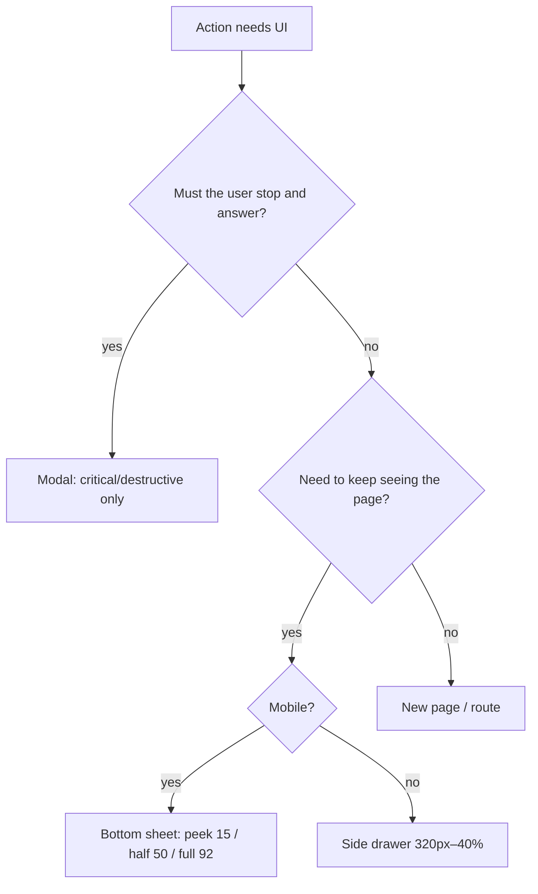

# Hierarchy, emphasis and actions

Rules sourced from Design Motion (designmotionhq.com patterns + Design Motion reels). Anything marked **(standard, not from Design Motion)** is a widely used industry standard added for completeness. Numbers marked "reel demo" are values shown on screen in a reel example, not universal laws.

Severity hint for reviewers: rules 1, 2, 10, 11 are usually **high** (they change what users click); the rest are **medium/low** polish.

---

### 1. One primary action per view

**Rule** Each view has exactly one visually dominant (filled/accent) action. Every other action is a secondary/ghost button or a text link.

**Why** Two equal buttons split the click. Design Motion's "click weight" demo: two same-size buttons side by side = **50 / 50**; one primary + one text link = **90 / 10** ("one primary takes the click").

**Numbers**
- Filled/accent buttons per view: **1**
- Pricing pages: **1** primary button on the whole page, not one per tier.

**Schema**
```
BAD                               GOOD
[ Get started ] [ Learn more ]    [ Start free trial ]   See how it works →
   50%             50%                 90%                   10%
```

**Good vs Bad**
```jsx
// Bad
<Button variant="primary">Get started</Button>
<Button variant="primary">Learn more</Button>
// Good
<Button variant="primary">Start free trial</Button>
<a className="link">See how it works →</a>
```

**How to check** Count filled/accent buttons per screen (and per pricing page). Count > 1 = finding.

**Source** https://designmotionhq.com/patterns/de-ai-landing-hero · https://designmotionhq.com/patterns/von-restorff · https://designmotionhq.com/patterns/visual-hierarchy · https://www.facebook.com/reel/1445609737415311 · https://www.facebook.com/reel/1361704646040572

---

### 2. Spend the accent colour like currency (one colour, everything else grey)

**Rule** Keep the UI neutral. Reserve one accent for the primary action and the current selection. Status, tags and categories use grey text/icons, not a rainbow of pills. Red is a separate, tiny budget reserved for destructive actions (see rule 11).

**Why** A rainbow flattens everything into noise. Linear teardown: "One color. Everything else grey." The AI-made dashboard tell: four KPI tiles with four colored icon tiles (green/purple/orange…) — "four colors, four numbers"; fix: "the number is the hero".

**Numbers**
- Accent colours: **1** (Linear demo goes from **7** colours to **1**).
- KPI icon tiles with distinct colours: **0**.
- Gradients as decoration on dashboards: **0** → "one flat accent".

**Schema**
```
BAD  [🟢 Revenue] [🟣 Users] [🟠 Conv.] [🔴 Churn]   ← 4 colours, no meaning
GOOD  Revenue  Users  Conv.  Churn                   ← grey labels, numbers big
      accent only on: primary button + selected row
```

**Good vs Bad** Good: accent only on selected nav item + "New issue" button. Bad: seven coloured status pills, each tag a different hue, gradient header card.

**How to check** List every element using the accent hue. Anything that is not primary action / selected state / focus = finding. Count distinct non-neutral hues on the screen (excluding semantic error red); > 1 = finding.

**Source** https://designmotionhq.com/patterns/visual-hierarchy · https://designmotionhq.com/patterns/reverse-engineered-linear · https://www.facebook.com/reel/882296604820252 · https://www.facebook.com/reel/1562348875576398

---

### 3. Stack size, weight, ink and space for one focal point

**Rule** Make one element the clear entry point by stacking signals: bigger size, heavier weight, stronger ink, more space around it. On dashboards: **one primary metric, three secondary** — not four identical cards.

**Why** Size alone does not create hierarchy. "Same size, same weight" is an AI-dashboard tell.

**Numbers**
- Primary element ≈ **2×** body size.
- Weights: **2** — 400 (body) and 600 (headings/emphasis) (typography reel).
- Supporting text ≈ **55% opacity** (pattern page).
- Dashboard KPIs: **1 primary + 3 secondary**.

**Schema**
```
┌──────────────────────────────┬─────────┐
│ Revenue · Aug 1–31           │ Users   │
│ $48,250        (large, 600)  │ 2,340   │
│ +12.5% vs last month (muted) ├─────────┤
│ Subscriptions  One-time      │ Conv.   │
├──────────────────────────────┤ Churn   │
```

**Good vs Bad** Good: `font-weight:600` title + 55%-opacity description. Bad: 4 KPI cards, all 24px/600, same colour, same size.

**How to check** Squint/blur test: one obvious entry point? Title and body at the same weight/opacity = finding. Dashboard with N equal KPI cards = finding.

**Source** https://designmotionhq.com/patterns/visual-hierarchy · https://designmotionhq.com/patterns/perfect-card · https://www.facebook.com/reel/1562348875576398

---

### 4. Cards are a system: one entity, one action, no nesting

**Rule** Card anatomy is Container → Title → Supporting → Primary → Secondary, with actions anchored at the bottom inside the card. Plus the card-system rules from the reel:
1. **One card, one entity** (a project, a person) — not a grab-bag of settings.
2. **The background picks the treatment**: on white use border or shadow; on an off-white (#FAFAF5/#FAFAFA in the demo) a flat white card is enough.
3. **One surface, one action**: if the whole card is clickable, extra actions go in a menu ("menu for the rest").
4. **Never nest cards** — inside a card use dividers/rows, not cards.
5. **One media ratio across the grid**.
6. **Dark mode kills shadows** → use lighter surfaces/borders instead (see visual file).

**Why** Predictable anatomy makes scanning instant; nested cards and mixed ratios create visual noise.

**Numbers** Cards per entity: **1**. Card nesting depth: **1** (max). Media aspect ratios per grid: **1**. Whole-card click targets with extra inline buttons: **0** (put them in a menu).

**Schema**
```
┌────────────────────────┐
│ [media, fixed ratio]   │
│ Title                  │
│ Supporting (muted)     │
│            [Primary] ⋯ │  ← actions bottom, rest in ⋯ menu
└────────────────────────┘
BAD: ┌ card ┌ card ┌ card ┐┐┐
```

**How to check** Look for cards inside cards, cards mixing several entities, clickable cards with multiple inline buttons, differing image ratios in one grid, actions overlapping the title.

**Source** https://designmotionhq.com/patterns/card-hover-anatomy · https://designmotionhq.com/patterns/perfect-card · https://www.facebook.com/reel/1638166994563234

---

### 5. Group by proximity before borders

**Rule** Gap inside a group < gap between groups. Use whitespace before adding lines or boxes. Group nav and toolbars by function.

**Numbers** Example from source: **~12px** within a form group vs **~40px** between groups.

**Schema**
```
Personal          ← 12px between fields
 [Name ]
 [Email]
                  ← 40px between groups
Payment
 [Card ]
```

**Good vs Bad** Good: "Personal" and "Payment" separated by space. Bad: 8 evenly spaced sidebar links; a divider between every field.

**How to check** Measure intra- vs inter-group spacing. Equal spacing everywhere or dividers where spacing would do = finding.

**Source** https://designmotionhq.com/patterns/proximity-rule · https://designmotionhq.com/patterns/gestalt-laws

---

### 6. Gestalt grouping: similarity, common region, continuity, figure-ground

**Rule** Related items share a visual property, align on one axis, sit in a shared container when they are far apart; dim/blur the background behind modals.

**Why** The brain groups pre-attentively, before reading.

**How to check** Scattered alignment, related controls not grouped, modals without scrim/blur = findings.

**Source** https://designmotionhq.com/patterns/gestalt-laws

---

### 7. Bookend sequences (serial position effect)

**Rule** Put the strongest items first and last; the middle is the "skip zone".

**Numbers** (reel recall data, 9 items) first item ≈ **88%** recall, last ≈ **78%**; navbar demo: logo **89%**, middle links **12%**, CTA **76%**.

**Schema**
```
Navbar:   [Logo] link link link link [CTA]
           89%    ←—— 12% ——→         76%
Landing:  Strongest USP (hero) → skip zone → strongest proof (testimonial/logos/case study)
Onboarding: slide 1 hooks … slide N pays off ("You're set. Time to ship")
```

**Good vs Bad** Good: logo first, primary CTA last. Bad: the key CTA as link #4 of 7; best testimonial in the middle of the page.

**How to check** Inspect order of nav, lists, landing sections, onboarding slides. Key item in the middle = finding.

**Source** https://designmotionhq.com/patterns/serial-position · https://www.facebook.com/reel/1159162060607416

---

### 8. Isolate the one choice you want made (Von Restorff / pricing)

**Rule** Against a uniform baseline, emphasise exactly one option (scale + badge + elevation, not colour alone) and calm the rest. Pricing specifics:
- **Only one tier gets the highlight**; "a badge on every card is a badge on none".
- **List what changes, not what repeats** ("Everything in Starter, plus…").
- **One primary button on the page**.
- **Write the annual saving in money**, not just "%".

**Numbers** Highlighted tiers: **1**. Badges: **1**. Primary buttons: **1**.

**Schema**
```
┌Starter┐ ┌★ Most popular┐ ┌Business┐
│ $19   │ │ Team  $49    │ │ $129   │
│[ghost]│ │ [ PRIMARY ]  │ │[ghost] │
└───────┘ └──(raised)────┘ └────────┘
Toggle: Monthly | Yearly — "save $X/yr"
```

**Good vs Bad** Good: "Everything in Starter, plus: multi-entity, VAT reports". Bad: three identical cards each with a "Popular" badge and its own filled button; "Save 20%".

**How to check** Count highlighted tiers/badges/filled buttons; check feature lists for repeated rows; check the billing toggle shows a currency amount.

**Source** https://designmotionhq.com/patterns/von-restorff · https://www.facebook.com/reel/1361704646040572

---

### 9. Concrete over decoration (de-AI the page)

**Rule** Replace AI-made tells with real product:
1. **Headline**: outcome + audience in plain words, no adjectives ("Close the month in one afternoon. Bookkeeping for small teams, without the spreadsheet.").
2. **Blob**: colour goes on the product, not on blurred gradient blobs behind everything.
3. **Two buttons**: one primary + one text link (rule 1).
4. **Proof**: one real quote with **name, role and a result with a unit** beats "Trusted by 10,000+ users".
5. **Feature cards**: show the product (real screenshot/UI), not icon-in-circle + "Fast / Secure / Easy".
Dashboards: "Welcome back, {name}" is copy with nothing to say — label the data instead ("Revenue · Aug 1 to Aug 31"); give numbers a shape (sparkline, delta "+0.4 pt").

**Numbers** Decorative blobs: **0**. Unverifiable proof counts: **0**. Testimonial fields: **3** (name, role, result with unit).

**Good vs Bad**
```
Bad:  "The all-in-one platform to supercharge and scale your business"
Good: "Close the month in one afternoon."
Bad:  "Trusted by 10,000+ users" + 6 fake logos
Good: "We closed August in three hours. It used to take a week." — Name, Head of Finance, Company
```

**How to check** Flag words like supercharge/seamless/powerful/all-in-one; blurred gradient blobs; icon+adjective feature rows; unverifiable user counts; greeting headers on dashboards.

**Source** https://designmotionhq.com/patterns/de-ai-landing-hero · https://designmotionhq.com/patterns/landing-page-skeleton · https://www.facebook.com/reel/1445609737415311 · https://www.facebook.com/reel/1562348875576398

---

### 10. Pick the right container: page, sheet, drawer, modal (new)

**Rule** Ask two questions: *does the user need to keep seeing the page?* → sheet/drawer; *must the user stop and answer?* → modal. Modals only for critical or destructive decisions. Popovers stay anchored to their trigger. Navigation never goes inside a blocking overlay — use an edge drawer.
- Mobile sheet: **three heights, nothing between** — peek / half / full (no free height).
- Desktop: a **bounded side drawer**, not a stretched mobile sheet.
- **One sheet at a time** — replace content, don't stack sheets.

**Numbers** (reel demo) snap points peek **15%**, half **50%**, full **92%** of viewport height; desktop drawer min **320px** (form breaks at **240px**), max **40%** of width. Open sheets at once: **1**.

**Schema**


**Good vs Bad** Good: "Edit delivery address" in a half sheet over the order. Good: "Delete account? Your orders, returns and saved addresses go with it. This can't be undone." as a modal. Bad: address edit as a full-screen modal that hides the order; a second sheet stacked on the first.

**How to check** For each overlay: classify blocking vs not; sheet with free/arbitrary height = finding; desktop drawer < 320px or > 40% = finding; > 1 stacked sheet = finding; full-screen scrim for routine action = finding.

**Source** https://designmotionhq.com/patterns/modal-hierarchy · https://designmotionhq.com/patterns/bottom-sheets · https://www.facebook.com/reel/1111460338008332

---

### 11. Destructive actions are a design language (new)

**Rule**
1. **Hold to confirm** replaces "Are you sure?" — the progress ring *is* the confirmation; releasing early does nothing.
2. **Name the action**: verb + object ("Delete project"), and say what goes ("removes Q3 Campaign and its 84 assets for everyone"). Never "Yes".
3. **Placement**: off the happy path — never in the spot where the confirm/primary button usually sits.
4. **Red is a budget**: red only for destructive actions, not logout, badges, banners.
5. **Danger zone**: bury irreversible settings at the bottom of settings.
6. **Cooldown**: irreversible deletions get a cancelable delay ("permanent on {date} — N days to cancel").

**Numbers** (reel demo) hold duration ≈ **300ms** ring fill; cooldown example **13 days** left. Red elements that are not destructive: **0**.

**Schema**
```
Settings
 ├ General
 ├ …
 └ Danger zone  ┌──────────────────────────┐
                │ Delete repository  [hold ◔]│
                └──────────────────────────┘
Dialog:  [Delete draft]   ...   [Keep editing (primary)]
```

**Good vs Bad**
```
Bad:  "Are you sure?"  [Cancel] [Yes]
Good: "Delete this project?" This permanently removes Q3 Campaign and its 84 assets for everyone on the team.
      [Cancel]  [Delete project]
```

**How to check** Search for "Are you sure"/"Yes"/"OK" on destructive dialogs; check destructive button position vs primary position; inventory all red usages; irreversible deletes without undo or cooldown = finding.

**Source** https://designmotionhq.com/patterns/destructive-actions · https://www.facebook.com/reel/1052845123926917

---

### 12. Navigation matches platform and depth (new)

**Rule** Mobile = bottom tabs, desktop = persistent sidebar. Hamburger only for *secondary* nav. Command palette (⌘K) is an accelerator for power users, never the only path. Breadcrumbs only when hierarchy depth > 2.

**Numbers** Bottom tabs: **3–5** destinations. Sidebar justified at **5+** sections. Breadcrumbs when depth **> 2**. Hiding primary nav in a hamburger: engagement drops **40–56%** (pattern page claim).

**Schema**
```
Mobile:  ┌──────────────┐        Desktop: ┌────┬──────────────┐
         │   content    │                 │nav │ Ws › Proj › X│
         ├──┬──┬──┬──┬──┤                 │ 5+ │   content    │
         │⌂ │▤ │✓ │🗓 │☰│ 3–5 tabs         └────┴──────────────┘
```

**How to check** Count primary destinations; primary routes inside hamburger = finding; feature reachable only via ⌘K = finding; breadcrumbs on ≤ 2-level structure = finding.

**Source** https://designmotionhq.com/patterns/navigation-patterns · https://www.facebook.com/reel/1274160754364058

---

### 13. Polish the peak and the end (Peak-End rule) (new)

**Rule** Users remember a flow by its best moment and its last moment, not the average. Design one intentional delight peak and a strong ending (e.g. success screen after checkout/signup); a bad ending ruins an otherwise good flow.

**Numbers** (reel) two paths with the same average satisfaction (**65**) are remembered differently; "one delight beats five neutrals".

**Schema**
```
satisfaction
  ▲      ★peak              ★end
  │  ──/  \────────────────/      ← remembered
  └────────────────────────────▶ time
```

**Good vs Bad** Good: checkout ends with a confirmation + order summary + what happens next. Bad: flow ends on a blank redirect or an error toast.

**How to check** Inspect the final screen of each key flow (signup, checkout, onboarding): is there a clear success state? Any flow ending in a dead end = finding.

**Source** https://www.facebook.com/reel/1458686142145780

---

### 14. Leave a meaningful loop open (Zeigarnik effect) (new)

**Rule** Unfinished tasks stay in memory and pull users back. Use progress indicators for real outcomes ("Your profile is 30% done", leave 1 onboarding box unchecked), but tie them to outcomes the user wants, not chores for you (not "subscribe to newsletter").

**Numbers** (reel) complete task → brain forgets; open loop → ~**80** retention in the demo chart; example "profile is **30%** done".

**Good vs Bad** Good: "Add 3 more skills to reach profile strength: strong". Bad: checklist item "Follow us on social media".

**How to check** Does onboarding show progress toward outcomes? Are checklist items user value, not marketing chores?

**Source** https://www.facebook.com/reel/1402071608435107

---

### 15. Words are part of the hierarchy (microcopy) (new) (merged)

See **forms-and-requests.md § 6 (Button labels and errors); placeholders: forms § 2; empty states: onboarding-and-empty-states.md § 6** — canonical rule; merged here to avoid duplication.

