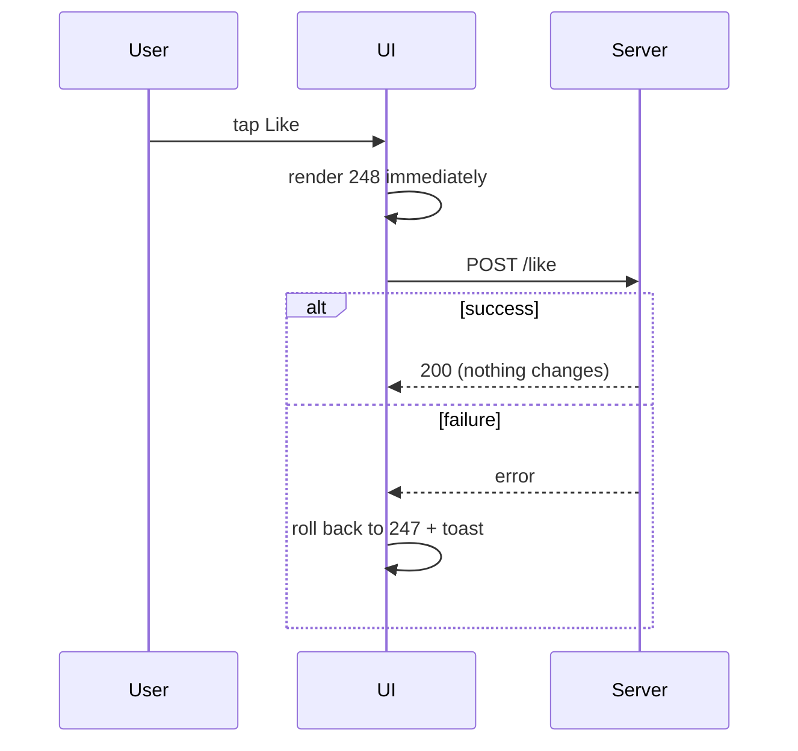

# Motion and animation

Rules sourced from Design Motion (designmotionhq.com patterns + Design Motion reels). Anything marked **(standard, not from Design Motion)** is an industry standard added for completeness. Numbers marked "reel demo" are values shown in a reel example.

Cheat sheet (from the timing reel + pattern page):

| Motion type | Duration | Easing |
|---|---|---|
| Tap / press feedback | **< 100ms** | — |
| Entrance (modal, toast, panel) | **200–300ms** (≈250ms) | ease-out |
| Exit | faster than entrance: **250 → 150ms** | ease-in |
| Move on screen | — | ease-in-out |
| Attention (error, notification) | **500–800ms** | bounce / overshoot |
| List stagger | **50ms** between items | ease-out |
| Dense pro tool hover | **80ms**; transitions max **150ms** | no overshoot |

---

### 1. Entrances 200–300ms ease-out; exits faster

**Rule** Entrances 200–300ms with ease-out. Exits clearly faster than entrances. Never linear for UI that starts and stops. Keep a duration scale from **100ms** (micro) to **500ms** (complex transitions).

**Why** 50ms is "too fast" (nothing registers), 700ms is "too slow" (in the way). Same speed in and out = sluggish exit.

**Numbers** Too fast **50ms** / perfect **250ms** / too slow **700ms**. Exit: **250ms in → 150ms out**. Design Motion states this as "exits are 30% faster" (reel) and "roughly 40% faster" (pattern page) — the concrete pair is 250/150.

**Schema**
```
open  ▁▂▄▆█  250ms ease-out (fast start, soft landing)
close █▆▃▁   150ms ease-in
```

**Good vs Bad**
```css
/* Good */
.modal[data-state=open]   { animation: in 250ms cubic-bezier(0,0,.2,1); }
.modal[data-state=closed] { animation: out 150ms cubic-bezier(.4,0,1,1); }
/* Bad */ .modal { transition: all 400ms linear; }
```

**How to check** Read every transition/animation duration + easing. Entrance > 300ms, exit ≥ entrance, or `linear` on UI motion = finding.

**Source** https://designmotionhq.com/patterns/animation-timing · https://designmotionhq.com/patterns/easing-curves · https://designmotionhq.com/patterns/design-system-kit · https://www.facebook.com/reel/899027719817805

---

### 2. Feedback under 100ms; responses under 400ms (Doherty threshold) (merged)

See **feedback-and-states.md § 1 (Feedback under 100 ms; response within 400 ms)** — canonical rule; merged here to avoid duplication.

---

### 3. Attention motion is rare and longer

**Rule** Only things that must grab the eye (an error needing attention, an incoming notification) get 500–800ms with bounce/shake. A smooth fade on an error is "boring" — it gets missed.

**Numbers** **500–800ms** + bounce/overshoot.

**How to check** Bounce/shake on routine UI = finding; critical error appearing with no attention motion = finding (low).

**Source** https://designmotionhq.com/patterns/animation-timing · https://www.facebook.com/reel/899027719817805

---

### 4. Stagger lists ~50ms

**Rule** Lists, menus and card grids cascade in with a small per-item delay.

**Numbers** **30ms** blurs into one blob, **50ms** is the sweet spot, **100ms** crawls. Card hover revealed actions: **~60ms** apart.

**Good vs Bad**
```css
.item { animation: in 250ms ease-out both; animation-delay: calc(var(--i) * 50ms); }
```

**How to check** Measure delay between items; < 30ms or ≥ 100ms = finding. Cap total so long lists don't take seconds (only stagger the visible items).

**Source** https://designmotionhq.com/patterns/animation-timing · https://designmotionhq.com/patterns/card-hover-anatomy · https://www.facebook.com/reel/899027719817805

---

### 5. Subtle springs only where attention is earned

**Rule** Small overshoot on presses, modals and confirmations; never a wobble. Dense pro tools: no bounce at all, hover **80ms**, transitions **≤150ms**, "max overshoot" = none — "the UI answers first".

**Good vs Bad** Good: confirm button scales 0.97 → 1 with a small spring. Bad: a sidebar item bouncing three times on hover.

**How to check** Count oscillations in spring animations (> 1 visible overshoot = finding). In dense tools, any transition > 150ms or bounce = finding.

**Source** https://designmotionhq.com/patterns/easing-curves · https://designmotionhq.com/patterns/reverse-engineered-linear · https://www.facebook.com/reel/882296604820252

---

### 6. Coupled parts move as one (toggle, accordion, tabs)

**Rule** Parts of one control share one curve and one duration.
- **Toggle**: don't snap — morph **4 properties** together: rail colour, knob slide (`translateX`), knob shadow, label. Anatomy: width = **2× knob**, padding = knob radius.
- **Accordion**: chevron and panel share one curve.
- **Tabs**: indicator *slides* (no hard cut); content **fades out → short pause → fades in**; container height interpolates so nothing below jumps.

**Numbers** Toggle **~250ms** ease-out. Tabs (reel demo): indicator `spring({ damping: 22, stiffness: 200 })` vs smooth slide **~280ms**; content fade **180ms**; pause **~80ms** (pattern page). Hard cut = **0ms** = bad.

**Schema**
```
Tabs:  Overview  Activity  Settings
       ════════→ (indicator slides)
content: fade out 180ms · pause ~80ms · fade in 180ms · height interpolates
```

**Good vs Bad**
```css
.knob { transition: transform 250ms ease-out, box-shadow 250ms ease-out; }
.rail { transition: background-color 250ms ease-out; }
/* Bad: knob jumps instantly while rail fades 400ms later */
```

**How to check** Compare durations/easings across the parts of each control; mismatch or instant jump of any part = finding. Tab switch causing layout shift below = finding.

**Source** https://designmotionhq.com/patterns/accordion-disclosure · https://designmotionhq.com/patterns/tabs-system · https://designmotionhq.com/patterns/toggle-anatomy · https://www.facebook.com/reel/27114469058187838 · https://www.facebook.com/reel/979499467901827

---

### 7. Hover lifts don't change geometry

**Rule** Lift the card and grow its shadow together; scale the image *inside* an `overflow:hidden` frame; never scale the whole card (it pushes/overlaps neighbours). Hover is a desktop enhancement — never the only way to reveal an action on touch.

**Numbers** Lift **~8px**, **~200ms ease-out** (faster = twitchy, slower = stuck).

**Good vs Bad**
```css
.card { transition: transform 200ms ease-out, box-shadow 200ms ease-out; }
.card:hover { transform: translateY(-8px); box-shadow: var(--shadow-lg); }
.card img { transition: transform 200ms ease-out; } .card:hover img { transform: scale(1.05); }
/* Bad */ .card:hover { transform: scale(1.1); }
```

**How to check** Hover each card: do neighbours move or overlap? Duration far from 200ms? Hover-only actions on touch = finding.

**Source** https://designmotionhq.com/patterns/card-hover-anatomy · https://designmotionhq.com/patterns/perfect-card · https://designmotionhq.com/patterns/depth-layers · https://designmotionhq.com/patterns/hover-trap

---

### 8. Don't jump the layout

**Rule** Anchor the tapped accordion header in place; skeletons match the final layout; inline edit keeps the same font metrics; tab/content swaps interpolate height; restore scroll position when coming back from a detail page.

**How to check** Record a CLS trace (Lighthouse/Performance). Content shifting after load/expand/edit = finding. Back navigation landing at the top of a long list = finding.

**Source** https://designmotionhq.com/patterns/accordion-disclosure · https://designmotionhq.com/patterns/skeleton-loading · https://designmotionhq.com/patterns/inline-editing · https://www.facebook.com/reel/979499467901827 · https://www.facebook.com/reel/1862628335143062

---

### 9. Optimistic UI for reversible actions (new)

**Rule** Update the screen first, sync after; roll back immediately (with a message) if the request fails. Only for reversible actions (like, follow, save, reorder, settings toggles). **Irreversible = show the truth**: payments, transfers, deletes wait for the server.
Toggle variant: flip first, show a small spinner *inside the knob* while pending, roll back on failure.

**Numbers** Perceived-instant cutoff **400ms**; reel demo: server wait **0.8s** vs instant.

**Schema**


**How to check** Throttle network to Slow 3G: reversible actions should update instantly; force a 500 error: state must roll back. A "Paid" or "Sent" state shown before server confirmation = finding (high).

**Source** https://designmotionhq.com/patterns/optimistic-ui · https://www.facebook.com/reel/1737522820773693 · https://www.facebook.com/reel/27114469058187838

---

### 10. Feel instant without spinners (new, from Raycast teardown)

**Rule**
- **Stale first**: show the last results immediately, then refresh in place.
- No spinner for fast operations.
- Overlays over the app **blur** the background rather than a heavy dark veil.
- Every action shows its keyboard shortcut; a bottom action bar names the default (↵) action.

**Numbers** (reel demo) results in **~40ms**; the "don't" example is a **60%** black dim veil.

**How to check** Reopen a search/list: does it show cached results instantly or a spinner? Spinner for < 400ms operations = finding.

**Source** https://www.facebook.com/reel/1675555607481018

---

### 11. Gestures: velocity closes, snap points decide (new)

**Rule** Bottom sheets and swipe dismissals close on **flick speed OR distance**, never distance only (distance-only feels "stuck"). Release always animates to a defined snap point — never rests at a free height.

**Numbers** (reel demo) velocity threshold **1.4 px/ms**; distance threshold **80px**; snap points peek **15%** / half **50%** / full **92%**.

**Schema**
```
on release:
  if velocity > 1.4 px/ms or dragged > 80px → close
  else → snap to nearest of [15%, 50%, 92%]
```

**How to check** Quick short flick on a sheet: does it close? Slow drag released mid-way: does it snap to a defined height? Free resting height = finding.

**Source** https://designmotionhq.com/patterns/bottom-sheets · https://www.facebook.com/reel/1111460338008332

---

### 12. Drag feedback: lift, placeholder, limits (new)

**Rule** The dragged item **lifts** (scale + shadow + slight tilt); the drop target shows a **placeholder the height of the card**, not a thin line; columns show WIP limits in the header; long boards collapse columns instead of horizontal scrolling; group with swimlanes, not separate boards.

**Numbers** (reel demo) lift **scale 1.03**, **+8px** shadow, **3°** tilt.

**Good vs Bad**
```css
.dragging { transform: scale(1.03) rotate(3deg); box-shadow: var(--shadow-float); /* reel: +8px shadow */ }
```

**How to check** Drag an item: flat preview or 2px insertion line only = finding.

**Source** https://designmotionhq.com/patterns/drag-and-drop · https://www.facebook.com/reel/1114841577734481

---

### 13. Continuity with view transitions (new)

**Rule** When an element becomes another (card → detail page, button → modal, theme toggle), morph it instead of cutting: give the shared element the same `view-transition-name` in both states; give every list row its own unique name; modals grow from their trigger button, not "from nowhere"; works across real page loads (cross-document view transitions).

**Good vs Bad**
```css
.card-hero  { view-transition-name: hero-lisbon; }   /* list */
.page-hero  { view-transition-name: hero-lisbon; }   /* detail */
@view-transition { navigation: auto; }               /* cross-page */
```
```js
document.startViewTransition(() => render(next));
```

**How to check** Open a detail from a list: does the item visually travel into place? Modal appearing centered with no origin = finding (low). Duplicate `view-transition-name` on one page breaks the transition = finding.

**Source** https://www.facebook.com/reel/1617431583257999

---

### 14. Smooth real-time motion (multiplayer) (new)

**Rule** Interpolate remote cursors/positions between network updates so they move at frame rate rather than jumping; render presence (who's here) before any messages.

**Numbers** Server **10 updates/s** → screen **60 frames/s** via interpolation.

**How to check** Watch a remote cursor: stepping/teleporting = finding.

**Source** https://designmotionhq.com/patterns/live-cursors · https://www.facebook.com/reel/1562882515556734

---

### 15. Respect reduced motion

**Rule** Honour `prefers-reduced-motion: reduce`: replace movement (slides, parallax, bounce) with opacity fades or instant changes. **(standard, not from Design Motion)**

```css
@media (prefers-reduced-motion: reduce) { *{ animation-duration:.01ms!important; transition-duration:.01ms!important; } }
```

**How to check** Enable reduced motion in OS settings; large movement still plays = finding.

**Source** WCAG 2.3.3 / platform guidelines (standard, not from Design Motion)
