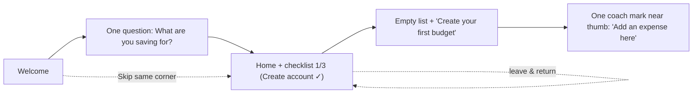

# Onboarding, empty states, progress and success

Sources: Design Motion pattern pages (designmotionhq.com/patterns) and Design Motion reels (facebook.com/reel/<id>, caption + on-screen text).
Anything not from Design Motion is marked "(standard, not from Design Motion)". Reel brand names ("Pennywise", "Hatch") are fictional demo apps.
Related: permission prompts during onboarding → forms-and-requests.md rule 1; multi-step forms → forms-and-requests.md rule 15.

---

### 1. Build a first run, not a tour

**Rule** "Every tour gets skipped. Build the first run instead." A first run has 5 pieces: (1) one question, then the app; (2) a checklist that opens already at 1/3; (3) an empty state with one button; (4) one coach mark near the thumb; (5) skip in the same corner on every step, and resume with progress kept.

**Why** Users skip multi-screen tours (the reel shows 11 screens and "screens read" counting down). Each piece instead teaches by doing.

**Numbers** 5 pieces; checklist 3 steps "about 2 min"; coach marks: 1 (past three tips, nobody reads).

**Schema**


**How to check** Count tour screens before reaching the real app (target: 1 question screen). Verify each of the 5 pieces exists.

**Source** https://www.facebook.com/reel/1142253738803098

---

### 2. One question, then the app

**Rule** Ask exactly one question that personalises the app ("What are you saving for? A trip · Rent · Emergency fund"), say "You can change it later", then drop the user into the app with their answer already used (e.g. checklist item "Your goal: A trip – Set your trip budget"). Move everything else ("Company size?", "How did you hear about us?") out of the path to value.

**Why** "Every extra question costs you" – questions before value hurt activation.

**Numbers** Questions before value: 1. Skip visible.

**Schema**
```
┌───────────────────────────┐
│                     Skip  │
│ What are you saving for?  │
│ [ ✈ A trip ] [ 🏠 Rent ]   │
│ [ ☂ Emergency fund ]      │
│ You can change it later.  │
└───────────────────────────┘
        ↓ answer used immediately on Home
```

**Good vs Bad** Bad: 4 screens of survey (role, company size, referral, goal). Good: 1 question whose answer changes the next screen.

**How to check** Count questions before the first useful screen = 1; the answer visibly affects the next screen; "change later" text present.

**Source** https://www.facebook.com/reel/1142253738803098

---

### 3. Setup checklist starts partly done and stays open

**Rule** Open on a checklist already at 1/3 (e.g. "Create account" ✓) – "Already started, so they go on." Leave one box unchecked: a visible, unfinished, *meaningful* item pulls users back. Tie it to an outcome they want ("one step from 100%"), not chores.

**Why** Zeigarnik effect: unfinished tasks hold weight ("INCOMPLETE = 2× memory weight"). "100% complete? You forget. 80%? It nags." Wrong fit: a newsletter nobody wants to finish; right fit: course progress toward a certificate.

**Numbers** Start at 1/3 (not 0/3); reel examples: setup 60%, profile 30% → "Add 3 more skills", open loop 80%.

**Schema**
```
Get started  1/3 · about 2 min
 ✓ Create account
 ○ Add your first budget   ← next, tappable
 ○ Set savings goal
```

**How to check** First view of checklist shows ≥1 item done. Every item links to the action. Items are outcomes the user wants. Progress persists across sessions.

**Source** https://www.facebook.com/reel/1142253738803098, https://www.facebook.com/reel/1402071608435107, https://designmotionhq.com/patterns/zeigarnik-effect

---

### 4. One coach mark, near the thumb

**Rule** Show at most one tooltip-style tip, pointing at the next action, placed in the thumb zone ("Add an expense here" by the + button).

**Why** "Past three tips, nobody reads."

**Numbers** Coach marks per screen: 1. Total before nobody reads: 3.

**How to check** Count coach marks shown on first run; check position is in the lower reachable area and points to a real control.

**Source** https://www.facebook.com/reel/1142253738803098

---

### 5. Skip in the same place every step; resume where they left

**Rule** "Skip, same corner, every step." Show step progress (step 1/3, 2/3). If the user skips or leaves, keep progress: "Come back, progress kept" – checklist still 1/3 or 2/3.

**How to check** Screenshot each onboarding step: Skip at identical coordinates. Kill the app mid-onboarding and reopen: same step/progress.

**Source** https://www.facebook.com/reel/1142253738803098, https://designmotionhq.com/patterns/stepper-wizard

---

### 6. An empty state is never empty: icon, human copy, one primary action

**Rule** Five empty-state rules: (1) one small illustration/icon (a blank void looks broken; an icon says "nothing is wrong"); (2) human tone in brand voice, not log output; (3) a mandatory primary CTA – the action they'd take if they knew what to do (optionally a secondary "or import from file"); (4) design per context; (5) use it to onboard.

**Numbers** 5 rules; 1 icon; 1 primary button (+ optional secondary link).

**Schema**
```
┌──────────────────────────────┐
│            ( 📁 )            │
│     Looks quiet in here      │
│ Add your first project and   │
│ your team will see it        │
│ instantly.                   │
│   [ + Add your first project ]│
│      or import from file     │
└──────────────────────────────┘
```

**Good vs Bad**
- Bad: "ERROR 404 · No items found. Result set empty. status: failed" / "Nothing to show – Try refreshing".
- Good: "Budgets show up here – Plan a trip, rent or rainy-day fund. [Create your first budget]".

**How to check** Open every list with no data: icon + one-sentence human copy + exactly one primary button; no system jargon.

**Source** https://www.facebook.com/reel/1626204088711096, https://www.facebook.com/reel/1142253738803098, https://designmotionhq.com/patterns/empty-states, https://designmotionhq.com/patterns/microcopy

---

### 7. Four kinds of empty, four designs

**Rule** Distinguish and design each:
| Context | Copy example (from reel) | Action |
|---|---|---|
| First run | "Welcome aboard – Let's set up your workspace in under a minute." | Start tutorial |
| No results | "No matches found – Try different keywords or check your spelling." | Clear search |
| Error | "Something broke – We couldn't load your data. Try again in a moment." | Try again |
| Filtered | "Hidden by filters" | Clear filters |

**Why** One generic "No data" message lies in 3 of 4 cases.

**How to check** Trigger all four (new account, nonsense search, offline, over-filtered); each shows its own copy and action.

**Source** https://www.facebook.com/reel/1626204088711096, https://designmotionhq.com/patterns/empty-states

---

### 8. Zero results is never a dead end

**Rule** Offer clear-search/filters, popular searches, category jumps or spelling alternatives.

**How to check** Search for nonsense; at least one recovery path is offered.

**Source** https://www.facebook.com/reel/1626204088711096, https://designmotionhq.com/patterns/search-experience-system, https://designmotionhq.com/patterns/empty-states

---

### 9. Use the empty state to teach

**Rule** "The empty state is your onboarding." Show a ghost/sample item ("This is how a task looks") and the drop target ("Drag files here to start") instead of a blank list.

**How to check** Empty list shows what a filled item will look like and how to create one.

**Source** https://www.facebook.com/reel/1626204088711096

---

### 10. Success is a system: say what happened, offer the next step

**Rule** Replace "Success! [OK]" with a specific confirmation – what, who, when ("Invoice sent to Northwind Labs · INV-2051 · €2,400.00 · due Oct 12, 2026 · sent just now"). Offer 1 primary next action + 1 way back ("Send another" / "Back to invoices"), never a dead end. 

**Why** "Three done screens. Only one keeps the user." A checkmark-only screen has 0 next steps.

**Numbers** Bad: 0 next steps. Good: 1 primary next + 1 way back.

**Schema**
```
 ✓ Invoice sent to Northwind Labs
   €2,400.00 · due Oct 12 · delivered to ap@…
   [ Send another ]   Back to invoices
   Sent ── Opened ── Paid   🔔 Notify me when paid
```

**How to check** Every completion screen names the object and the result and has a primary next action and a way back.

**Source** https://www.facebook.com/reel/1386079209898048, https://designmotionhq.com/patterns/peak-end-rule

---

### 11. Dismissal follows stakes

**Rule** Low-stakes success → toast that auto-dismisses, with Undo ("Notifications saved · Undo", countdown shown ~3s). High-stakes success (payment, upgrade) → a page/receipt that stays (plan, amount, card, date).

**Numbers** Reel toast countdown runs 3.2s → 0.2s (≈3s). High-stakes: stays until the user leaves.

**How to check** Save a preference → toast with Undo disappears by itself. Complete a payment → persistent receipt, not a toast.

**Source** https://www.facebook.com/reel/1386079209898048

---

### 12. Leave one open loop after success

**Rule** After a task completes, show what happens next and offer to follow it ("Sent → Opened → Paid · we'll notify you · Notify me when paid"). Then deliver the follow-up ("Northwind Labs opened INV-2051").

**Why** An open loop the user cares about brings them back (same mechanism as rule 3).

**How to check** Completion screen shows a status timeline or a "notify me" for the next real event.

**Source** https://www.facebook.com/reel/1386079209898048, https://www.facebook.com/reel/1402071608435107, https://designmotionhq.com/patterns/zeigarnik-effect

---

### 13. Celebrate the rare win – design the peak and the end

**Rule** Confetti/celebration only for milestones ("First invoice paid"), never for every save ("Saved Saved Saved" = noise). End every flow on a warm, specific final screen, never an error or dead end.

**Why** People remember the peak and the end, not the average. Celebration everywhere stops being a signal.

**Numbers** Celebrations: milestones only (first-of-kind, goals reached).

**How to check** List all celebration animations; each maps to a rare milestone. Review the last screen of every flow.

**Source** https://www.facebook.com/reel/1386079209898048, https://designmotionhq.com/patterns/peak-end-rule

---

### 14. Show long-flow progress so the end feels close

**Rule** Any multi-step setup shows where the user is (Step 2/4, labelled steps or bar) and keeps data across Back/refresh.

**Why** "Users need to feel the end is close." "Lose the form once, you lose the user forever."

**How to check** See forms-and-requests.md rule 15 for full checks.

**Source** https://www.facebook.com/reel/1532385908524073, https://designmotionhq.com/patterns/stepper-wizard
