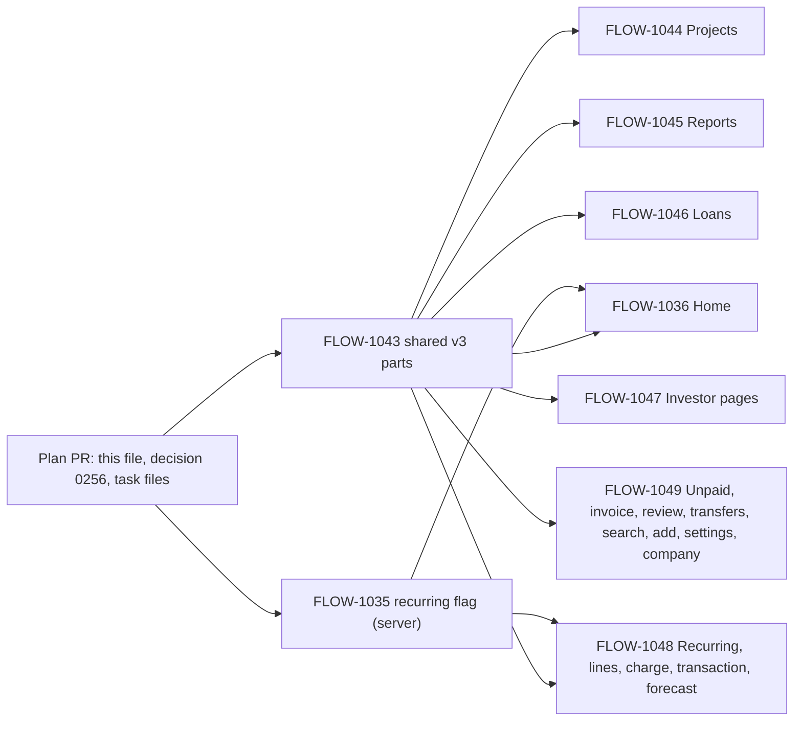

# Flow v3: the build plan (2026-11-05)

How the dev team builds the v3 design that [HANDOFF.md](HANDOFF.md) describes. The handoff says what each screen is; this file says in which order, in which PRs, on which shared parts, and what each PR must leave behind. The owner's go for the build: 2026-11-05 ("plan and build new design v3"). Decision [0256](../../decisions/0256-design-v3-composition.md) records why.

Read, in this order: the handoff, this file, then your task file under `docs/backlog/tasks/`, then the boards (the canvas, or their HTML copies the lane saved beside the brief).

## 1. Rules that hold for every v3 PR

1. **Composition, not components.** A screen composes `app/src/ui` parts. Where a board's inline value differs from the component, the component wins. Decision [0257](../../decisions/0257-v3-boards-win.md) reverses this for v3: the board's measurements win (§7). The only component work is in FLOW-1043 (§3), and it is additive: no existing prop changes meaning, no existing story breaks.
2. **One pattern per screen** (handoff §2): Overview, List, Detail, Sheet, Hub. Name the pattern in the PR body. A screen that needs a sixth pattern is a question for the design lead, not a new pattern.
3. **The data a screen shows comes from the reads it has today.** A new read is listed in the task file; a new user action ships its `flow-mcp` tool in the same PR ([0095](../../decisions/0095-mcp-first.md)). A view composed of existing reads needs no new tool.
4. **Delete what the composition leaves unused** in the same PR: the split card, the next-month card, the reports card, hand-rolled group heads, a screen's own compact bar, their CSS, stories and tests. `node scripts/check-unused-app-code.mjs` and the CSS check are part of `pr (types)`.
5. **Every PR:** a design log entry (`docs/design/log/2026-MM-DD-flow-<id>.md`), a changelog fragment, stories for every state on the `V3-States` board that applies (loading, failed with retry, offline, empty, long content), shots at 320 and 393 px in dark and light, reduced motion checked, 44 px targets, `<bdi dir="ltr">` on amounts.
6. **Claim and lanes** as in the [backlog guide](../../backlog/README.md): a draft PR with a `Claim` block before the first build commit, one PR per task, `Files` naming CSS blocks in the hotspot files. The waves in §2 say which PRs run at the same time; their file sets are disjoint by design, so a lane never waits on another except for the merge of FLOW-1043. A claim lives only in an open PR (backlog guide); a closed PR's task file holds no file.
7. **Reviewer and merge:** one reviewer per PR (code, pixels, motion), its APPROVED comment on the head, a green `pr` check, then a squash merge. Whoever merges second in a wave merges `main` into its branch first and re-shoots any screen the other PR changed (DESIGN-TEAM §Splitting work, rule 5).

## 2. Order and waves



| Wave | PRs at the same time | Why this grouping |
| --- | --- | --- |
| A | FLOW-1043 (app/src/ui, its CSS and docs) and FLOW-1035 (supabase, packages/shared and docs) | No file in common. Everything else needs 1043's parts |
| B | FLOW-1036, FLOW-1044, FLOW-1045, FLOW-1046 | Home, Projects, Reports, Loans: the four tabs. Each owns its screen files and its own CSS files (§4) |
| C | FLOW-1047, FLOW-1048, FLOW-1049 | The pages under the tabs. 1048 reads 1035's flag; 1047 touches only the investment and returns files, so it may start with wave B when a lane is free |

Wave B starts when FLOW-1043 has merged (and FLOW-1035, for Home's one-off group; Home works without the flag, §5). Wave C starts when its lane is free; it does not wait for wave B to merge, since the files are disjoint, but the second to merge re-shoots (§1.7).

Out of scope for v3 (handoff §8): Settings sub-pages, setup and onboarding, sign-in, help and legal, install, split and journal composer, next-month edit. `/profit` (the company profit page) stays as it is; the owner's "two reports" rule removes its entry points from Home, not the page. Its retirement is a follow-up task once Reports v3 covers what it shows.

## 3. The shared parts (FLOW-1043): the contract every screen builds on

All in `app/src/ui`, each with a story and a test. Additive only.

### 3.1 The compact bar docks a control

`CompactBar` (`compact-bar.tsx`) gains two props:

```ts
/** A row under the bar that holds a control while `docked` (the filter that reached the bar). */
dock?: ReactNode;
/** The dock row is open: the bar grows by 60px (max-height, --motion-page, --ease-enter), the row fades in (160ms). */
docked?: boolean;
```

- The dock row is always rendered when `dock` is set, so it can animate: `max-height: 0; opacity: 0` closed, `max-height: 60px` open. Closed, it is `inert` and `aria-hidden`.
- The bar reports its height to the page as today (`html[data-compact-bar]`, `27-compact-header.css`), with two additions: a bar with `centre` (Home's band bar) reports `band`, 64px (its real height, 6 + 52 + 6; today it is counted as a 44px list bar), and an open dock adds `html[data-compact-dock="on"]`, which adds 60px to `--compact-bar-h`. `--month-sticky-top` and `scroll-padding-block-start` follow from `--compact-bar-h` as today, so sticky heads and Tab stops land under the dock. That gives the handoff's offsets: 0, 64, 124 on an Overview screen; 56 (the detail bar) or 116 on a List screen, and 44 or 104 on a list bar.
- An Overview bar keeps the band tone (`tone="band"`); a List bar is the surface-coloured bar it is today.

### 3.2 The docking hook

`dock-filter.tsx`:

```ts
export function useDockedFilter({ barShown, bar }: { barShown: boolean; bar: number }): {
  /** A callback ref for the zero-height mark placed right above the in-page control. */
  markRef: (node: HTMLElement | null) => void;
  /** The mark has scrolled under the bar while the bar shows. */
  docked: boolean;
  /** After a pick while docked: scrolls so the list's top sits under the bar (smooth; instant under reduced motion). */
  scrollUnderBar: () => void;
};
/** Wraps the in-page control: fades it out (160ms) while docked and keeps its height, so the page does not jump. */
export function DockSlot({ docked, children }: { docked: boolean; children: ReactNode }): JSX.Element;
```

It is built on `useScrolledPast` (`screen-header.tsx`): the same observer the stacked header uses, with the bar's height. A screen renders one `SegmentedControl` in the page inside `DockSlot` and the same control (same `value`, same `onChange`) in the bar's `dock`; the state lives in the screen. `bar` is 64 on Home's band bar, `COMPACT_BAR` (44) or `DETAIL_BAR` (56) elsewhere.

### 3.3 The segmented control's selected pill slides

`SegmentedControl` draws its selected state as one `aria-hidden` indicator that moves between options (`transform`, `--motion-page`, `--ease-enter`), instead of a fill per button. Under reduced motion it jumps. On the band tone the indicator is white and the selected label is the accent colour, as the board draws it; the page tone keeps today's colours. The options keep their roles and keyboard handling (`onRadioArrow`). Every existing story still passes; the width under 360px with `short` labels is unchanged.

### 3.4 Group heads on one line

`GroupHead` gains `summary?: ReactNode`. With it, the head is one line: the title at the start (`t-section`, 20/500), the summary at the end (`t-meta`, secondary colour, for example "6 · $512 יצא"), baseline-aligned, 48px minimum, a 1px `--color-line` under it, the page background behind it. It sticks as today at `--month-sticky-top` and its `inset-block-start` transitions over `--motion-page` so it follows the dock. Without `summary`, today's two-line head is unchanged. The v3 screens that hand-roll a head (the Projects sections, the loan payments' year heads, the recurring groups) move to this.

### 3.5 Attention row-cards

`attention-cards.tsx` and `css/63-attention-cards.css`:

```ts
/** `BannerRow` gains `dismissKey?: string`: what the row counts, e.g. "changes:4" or "unpaid:3:2130000". A row without one cannot be hidden. */
export function AttentionCards({ rows, storageKey, title = "דורש טיפול" }: {
  rows: readonly BannerRow[];
  /** The screen's name: the hidden rows are kept under `flow.attention.<storageKey>`. */
  storageKey: string;
  title?: string;
}): JSX.Element | null;
```

- Each row is a 56px card: surface fill, `--color-line` border, radius `--radius-card-tight` (the existing 16px token in `implementation-tokens.css`), the row's icon, a one-line title (`t-body`, ellipsis), a chevron, and a 44px X with `aria-label="הסתרה: <title text>"`. A row with `button` (the review row) is the first card and has no X. The card body is the link.
- The X slides the card 24px toward itself, then folds it: `max-height` over `--motion-sheet-out` with `--ease-exit`, opacity 160ms. The section head shows "N הוסתרו · הצגה" when some are hidden; when every row is hidden the section is one 44px line, "אין מה לטפל · הכול נסקר" with a check in the income colour, and הצגת הכול (FLOW-1102). The section is `aria-live="polite"`.
- Persistence in `attention-dismiss.ts`: `readHidden(storageKey): Record<string, string>` (row id to dismissKey), `hideRow`, `restoreAll`. A row is hidden while its stored dismissKey equals its current one, so a changed count shows the row again. Every read and write is in try/catch; with no storage the cards work for the session.
- `max-height` is the one property animated beyond transform and opacity (handoff §6).

### 3.6 Status marks

`status-mark.tsx`: `StatusMark({ kind: "due" | "late" | "paid" | "once" })`, 24px, `aria-hidden`: a dashed 2px ring in the muted colour (`due`), the same ring in the signal colour (`late`), a check on a `--color-tint` disc (`paid`), a 6px dot (`once`). It is passed as a `ListRow` `icon`; the row's text says the state in words ("איחר", "צפוי ב-15"), so colour is never the only cue.

### 3.7 What is not built

The undo toast exists (`useToast().show({ message, action: "ביטול", onAction, onClose })`; the held write ends in `onClose`). Press feedback is `.m-press`. Page and row entrance is `.m-page-enter` with `--i`. Sheets are `Sheet` (Vaul). Forms already keep Save enabled and show the field error on tap. None of these change in v3.

## 4. Per area: what changes, what it reads, what is new

Each row names the task file that carries the detail. "Reads" are today's RPCs or tables; "new" marks data the build adds.

| Area | Task | Pattern | Reads it composes | New |
| --- | --- | --- | --- | --- |
| Home | [FLOW-1036](../../backlog/tasks/FLOW-1036.md) | Overview | `cash_months`, `cash_month_to_day`, `expected_months` (the forecast), `recurring_schedule`, `cash_month_lines` (the one-off group), `missing_bills`, `recurring_changes`, `list_unpaid`, `get_dashboard` | `recurring` on `cash_month_lines` ([FLOW-1035](../../backlog/tasks/FLOW-1035.md)) |
| Projects | [FLOW-1044](../../backlog/tasks/FLOW-1044.md) | Overview (list, project page, project profit), List (lines with no project), Sheet (new project, actions) | `projects_cash_month`, `project_cash_months`, `get_project`, `get_profit_months`, `missing_bills`, `project_recurring_changes`, `expected_months`, `search_transactions` (`project=none`) | A route for the lines with no project (`/projects/unassigned`), and the project kind as data the sheet and page read (today it is free text) |
| Reports | [FLOW-1045](../../backlog/tasks/FLOW-1045.md) | Hub, then Overview with a drill-down | `get_pnl_statement` (all, by project, one project, a month), `get_profit_months` (by month), `mcp_balance_sheet` (all, per property) | Routes: `/reports` (hub), `/reports/pnl`, `/reports/balance`; the balance sheet by project composes one `mcp_balance_sheet` per property |
| Loans | [FLOW-1046](../../backlog/tasks/FLOW-1046.md) | Overview (list, loan page, summary), List (payments), Sheet (new loan, close) | `loans`, `loan_balances`, `loan_rates`, `mcp_loan_payments`, `projects` | None |
| Investor pages | [FLOW-1047](../../backlog/tasks/FLOW-1047.md) | Overview (investment), Detail (calculation pages) | `get_property_returns`, `get_property_return_lines`, `get_project` | None |
| Recurring, lines, charge, transaction, forecast | [FLOW-1048](../../backlog/tasks/FLOW-1048.md) | List, Detail, Overview-lite | `recurring_schedule`, `recurring_changes`, `cash_month_lines`, `get_transaction`, `expected_months` | The lines' "recurring or one-off" order reads FLOW-1035's flag |
| Unpaid, invoice, review, transfers, search, add, settings, company | [FLOW-1049](../../backlog/tasks/FLOW-1049.md) | List, Detail queue, Sheet | `list_unpaid`, `set_invoice_paid`, the review reads, the transfer-match reads, `search_transactions` | None |

### File ownership in waves B and C

Disjoint by construction; a lane that needs a file outside its set asks the coordinator rather than taking it.

| Task | Screens (`app/src/screens/`) | CSS (`app/src/ui/css/`) | Other |
| --- | --- | --- | --- |
| 1036 | `HomeScreen.tsx`, `home-parts.tsx`, `home-activity.tsx` (new), `attention-rows.tsx`, `month-drawer.tsx`, `home-skeleton.tsx`, `home-next-month.tsx` and `home-reports-card.tsx` (deleted), their stories and tests | `43-home.css`, `51-next-month.css` (deleted if unused) | `app/src/home-month.ts`, `app/src/recurring-schedule.ts` |
| 1044 | `projects-screen.tsx`, `project-detail-screen.tsx`, `project-cash-screens.tsx`, `project-page-cards.tsx`, `project-attention.ts`, `project-menu.tsx`, `project-form-sheet.tsx`, `project-profit-screen.tsx`, `project-unassigned-screen.tsx` (new), their stories and tests | `32-project-page.css`, `33-project-flip.css`, `45-project-profit.css`, `09-sign-in-project.css: project blocks only` | `app/src/routes/projects.tsx`, `app/src/project-list.ts`, a migration only if the kind becomes a column |
| 1045 | `reports-screen.tsx`, `reports-parts.tsx`, `reports-sheets.tsx`, `reports-hub-screen.tsx` (new), `report-lines-screen.tsx`, `report-account-screen.tsx`, their stories and tests | `61-reports.css` | `app/src/reports.ts`, `app/src/use-reports.ts`, `app/src/report-schemas.ts`, `app/src/App.tsx: the reports routes only` |
| 1046 | `loans-screen.tsx`, `loans-host.tsx`, `loans-list.tsx`, `loan-list.tsx`, `loan-summary-card.tsx`, `loan-detail-screen.tsx`, `loan-detail-cards.tsx`, `loan-detail-sheets.tsx`, `loan-payments-view.tsx`, `loans-summary-screen.tsx`, `loan-setup.tsx`, `loan-kind-sheet.tsx`, `loan-close-sheet.tsx`, their stories and tests | `46-loans.css`, `26-loan-row.css`, `29-loan-detail.css` | `app/src/routes/loans.tsx` |
| 1047 | `project-investment-screen.tsx`, `project-investment-cards.tsx`, `project-returns-*.tsx`, their stories and tests | `25-investment.css`, `26-returns.css` | `app/src/ui/investment-card.tsx` |
| 1048 | `recurring-screen.tsx`, `recurring-changes-screen.tsx`, `recurring-charge-screen.tsx`, `cash-lines-screen.tsx`, `cash-lines-parts.tsx`, `transaction-screen.tsx`, `transaction-top-bar.tsx`, `forecast-screen.tsx`, `forecast-parts.tsx`, `forecast-category-view.tsx`, their stories and tests | `39-recurring.css`, `48-recurring-charge.css`, `49-recurring-answers.css`, `36-cash.css`, `16-transaction.css`, `28-forecast.css`, `28-forecast-categories.css` | `app/src/ui/recurring-list.tsx`, `app/src/cash-lines-groups.ts` |
| 1049 | `unpaid-screen.tsx`, `invoice-screen.tsx`, `review-screen.tsx`, `review-queue.tsx`, `review-lists.tsx`, `transfers-screen.tsx`, `search.tsx`, `add-sheet.tsx`, `add-entry-sheet.tsx`, `settings-screen.tsx`, `company-switcher.tsx`, `company-sheet.tsx`, their stories and tests | `45-invoices.css`, `06-review-*.css`, `54-transfer-matches.css`, `19-search-screen.css`, `44-add-entry.css`, `10-settings-connect.css: the settings hub blocks only` | `app/src/routes/unpaid.tsx`, `app/src/routes/search.tsx`, `app/src/routes/add.tsx` |

`app/src/ui/index.ts` and `app/src/ui/ui.css` are append-only (DESIGN-TEAM). `app/src/App.tsx` is shared: 1045 changes the reports routes only, 1036 nothing; any other route change goes through its own `routes/*.tsx` file.

## 5. Decisions already made (so no lane asks)

- **Home without the flag.** Until FLOW-1035 is live, `recurring` is undefined on every line: Home shows נותר לשלם and קבועים ששולמו, hides the חד-פעמי group and the הכול option's third group, and the filter reads הכול / קבועים / נותר לשלם all the same. Nothing says "missing data".
- **The review row is a card without an X.** It counts work to do; hiding it would hide the queue. The other attention rows are dismissable.
- **Dismissal is per device and per screen** (`flow.attention.home`, `flow.attention.projects`, `flow.attention.project:<id>`, `flow.attention.loans`, `flow.attention.recurring`, `flow.attention.investment:<id>`), keyed by the row id and what it counts. No server write.
- **The toast with undo stays 5 seconds** (the component's value with an action), not the board's 4. The component wins.
- **The month drawer carries next month's forecast** (the next-month card's read, `useCompanyCashNextMonth`) when next month is selected, the month-end forecast on the current month, the final net on a past month, and "עוד לא" beyond next month. The pill's next arrow on the current month opens the drawer on next month.
- **Reports routes.** `/reports` is the hub. `/reports/pnl?view=category|project|month[&project=<id>|&month=YYYY-MM]` and `/reports/balance?view=assets|liabilities|project[&project=<id>]`. Old links (`/reports?kind=balance`, the project band's דוחות link) redirect to the new routes with their state. `/reports/lines` and `/reports/account` stay.
- **Balance sheet by project** composes one `mcp_balance_sheet(p_as_of, p_project_id)` per property project (`useQueries`, like the loans summary). A single server read is a follow-up if it proves slow (file it as a task from the PR).
- **The project kind** (renovation, rental, client, overhead) is read from the data the page already has: a project with a budget or ARV is a renovation, one with rent or a property value is a rental, one with a contract is a client project, the overhead project is overhead. If the new-project sheet needs to store the pick, FLOW-1044 adds a nullable `projects.kind` column with its migration and `upsert_project` argument, and the MCP `add_project` and `update_project` take it; otherwise no migration.
- **The lines with no project** get their own route, `/projects/unassigned`, a List screen over `search_transactions` with `project=none`, with "שיוך" opening the existing project picker sheet; the Projects link and the project profit's empty state go there instead of `/review` and `/search?project=none`.
- **Loan payments' year heads** become `GroupHead` with a summary; the hand-rolled `ui-loan-year-head` goes.
- **Recurring "X marks a change as seen"** uses the existing ignore-alert action (FLOW-447) with its undo; no new write.
- **Settings' מראה sheet** uses the existing theme store (`flow.theme`) and switches live; it exists in v2 and keeps its behaviour.

## 6. Checks before a lane says "done"

```bash
pnpm lint && pnpm typecheck && pnpm --filter @flow/app test
pnpm --filter @flow/app test:storybook        # the stories the change reaches
pnpm build-storybook && pnpm clip-check       # then read clip-report.txt
node scripts/story-shots.mjs --dir app/storybook-static --out <dir> <storyIds>   # 320 and 393, dark and light
node scripts/check-unused-app-code.mjs
```

For FLOW-1035 and any migration: the db part (`bash scripts/local-ci.sh --part db`), `pnpm db:types:check`, and the pgTAP file that names the change.

## 7. The pixel pass

Decision 0257 (2026-11-05): the boards' measurements win over the components' (this reverses §1.1 for v3). Each board renders standalone with the canvas runtime at 390×844; a story is shot at the same size, dark and light, and the two are laid side by side with a diff (the coordinator's `compare.cjs`; the method and the tooling are in the pass tasks' briefs). A pass is done when every pixel that is not sample data sits on the board's: block edges within 1px, the same font sizes, weights and colours, the same heights. Order: FLOW-1051 (the shared parts: the band, the compact bar and its dock, the section title, the attention cards, the segment, the group heads, the rows and status marks, the tab bar, the page padding), then FLOW-1052 Home, FLOW-1053 Projects, FLOW-1054 Reports, FLOW-1055 Loans in parallel; wave C's PRs run the same comparison before they are marked ready. Each PR's body carries the before and after percentages per pair.

## 8. After each wave

The coordinator confirms the deploy (`build.txt` on the Pages site shows the wave's last merge), does the read-only prod check on a real company, tells the MCP/data agent what moved (new tools, totals that will move), and marks the tasks `done (#PR)` in the next PR. The design lead folds each PR's `Rule:` lines into DESIGN-RULES in the cycle's backlog PR, and §2.8's inventory gains the dock, the one-line group head, the attention cards and the status marks.
